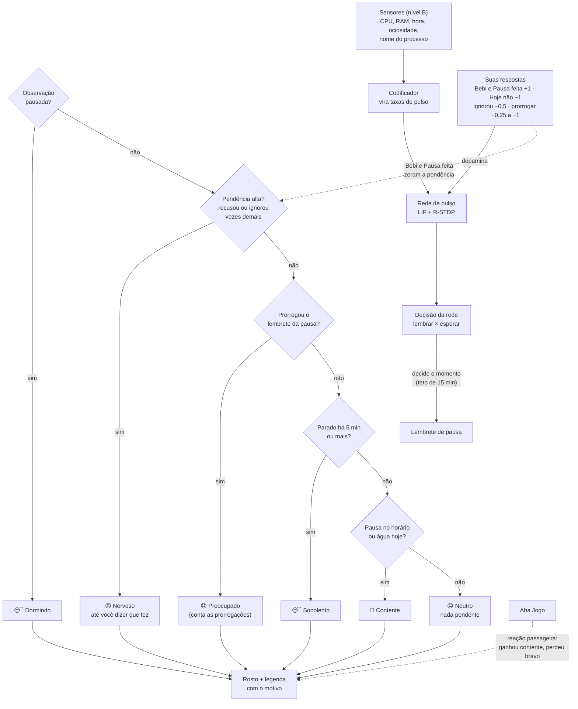

# Pulso

[](https://github.com/AndreiBataglia/pulso/actions/workflows/ci.yml)


[](LICENSE)


**Status: projeto inacabado, encerrado na v0.8.0 (2026-11-07).** O repositório fica aberto para quem quiser
aproveitar o que existe. Funcionam: os sensores, a rede que aprende, o Pulso na janela, a aba do cérebro, hábitos
(foco por presença, pausas e água), bandeja do Windows, ajustes, um jogo, a rede decidindo *quando* lembrar da pausa
e o modo **Remover o Pulso**. Veja [o que ficou por fazer](#o-que-ficou-por-fazer) e a
[nota de encerramento](docs/diario/encerramento.md).

## English

Pulso is a Windows desktop companion driven by a small spiking neural network
(leaky integrate-and-fire neurons with reward-modulated STDP, written in plain numpy).
It learns your rhythm from coarse signals only (CPU, RAM, time, idle time, foreground process name),
and helps you build routine: a focus cycle that starts by itself when you are at the PC, break reminders
and water reminders. It never reads keystrokes or window titles.

**Status: unfinished project, frozen at v0.8.0.** It stays public so anyone can reuse the code (the numpy spiking
network, the reward-modulated STDP, the focus cycle). Known gap: the network only learns *when* to remind you of a
break; with only coarse sensors there is little else it can learn. See [the closing note](docs/diario/encerramento.md).
To wipe everything the app stored: Settings → *Remover o Pulso*, or `pulso --remover`.

## Português

Pulso é um companheiro de desktop para Windows, movido por uma pequena rede neural de pulso
(neurônios LIF com R-STDP, em numpy puro). Ele aprende o seu ritmo a partir de sinais grosseiros
e ajuda você a criar rotina: foco, pausas e água. O projeto também é um diário de aprendizado: cada etapa
explica os conceitos usados em [`docs/diario/`](docs/diario/).

## Como o Pulso ajuda

O foco é **criar rotina sem ser chato**. O Pulso pergunta, você responde; ele nunca bloqueia nem controla a tela.


- **O foco começa sozinho.** Não existe botão *Iniciar*: quando você mexe no PC, o foco abre (50 min por padrão) e o
  anel em volta do rosto mostra o andamento. A pílula **Profissional / Casual** troca o modo.
- **Lembrete da pausa.** Ao fim do foco: **Pausar agora**, **Prorrogar 5 min** ou **Hoje não**. Pausa no horário
  deixa o Pulso contente; recusar ou ignorar soma pendência e o deixa nervoso.
- **Descanso.** O rosto descansa com a contagem. Se passar do combinado, ele só conta quanto, sem bronca.
- **"O que foi?"** Quando você volta de uma ausência, o Pulso pergunta: *pausa*, *refeição*, *necessidade* ou
  *foco sem mexer*. Refeição e necessidade nunca o deixam nervoso, e sem resposta conta como pausa.
- **Reunião.** Microfone em uso por outro programa **pausa** o foco, sem penalizar, e ele continua de onde parou.
  A câmera e o microfone nunca são usados como sensor de presença.
- **Modo casual.** Sem ciclo de foco: só o lembrete de água.
- **Água.** *Bebi* faz o Pulso beber com você. O placar do dia fica no rodapé (pausas, prorrogações, copos, focos).
- **Você manda nos tempos.** Em **Ajustes** (⚙ ou menu da bandeja): foco, descansos, intervalo da água, modo e
  quanto tempo parado conta como ausente.
- **O Pulso vive na bandeja do Windows**, com avisos, pode iniciar com o Windows (abrindo só na bandeja), ficar
  sempre à frente e ser reaberto pelo Menu Iniciar. Sair de vez é pelo ícone da bandeja.
- **Um jogo para o dia a dia.** Na aba **Jogo**, jokenpô e par ou ímpar: se o Pulso ganha, fica contente; se perde,
  fica bravo. O resultado muda só o rosto e o placar, nunca a rede.

## A rede de pulso

O Pulso aprende com o que **você** faz e responde, não com palpites: cada carinho, *Bebi*, pausa feita ou *Hoje não*
vira um sinal de recompensa (dopamina) para a rede. Não há mais recompensas automáticas por palpite (nome do
programa, tempo parado): a rede só aprende com o que você confirma.

**O que a rede decide:** quando o foco acaba, a rede escolhe entre **lembrar** (avisar da pausa já) e **esperar** (mais
um pouco, no máximo 15 min; depois o aviso toca de qualquer jeito). Ela decide a cada 10 s, olhando o contexto do
momento (hora, programa, tempo parado). Aceitar o lembrete reforça o que ela decidiu; prorrogar ou recusar enfraquece.
Uma rede sem treino lembra na hora, como o app sempre fez. O rosto do Pulso não depende dela: segue regras claras.


A aba **Cérebro** mostra a rede por dentro: raster de pulsos, potenciais, dopamina, a decisão lembrar × esperar e mapa de pesos.


### Como o humor funciona

O rosto mostra **um humor por vez**, e a legenda embaixo diz o motivo. Quem escolhe é um conjunto de **regras
explicáveis** (a primeira que vale ganha); a rede de pulsos não escolhe a cara:



- **As regras decidem o rosto**, nesta ordem: pendência → nervoso; lembrete prorrogado → preocupado; parado há 5 min
  ou mais → sonolento; pausa no horário ou copo hoje → contente; senão neutro.
- **A rede não escolhe o rosto.** Ela aprende com o que **você** responde (setas de dopamina) e decide *quando*
  lembrar da pausa: aceitar o lembrete reforça a decisão, prorrogar ou recusar enfraquece. Se o lembrete só tocou
  porque passaram 15 min, a resposta vale ao contrário (aceitar = esperar foi erro).
- **Nervoso** nasce de recusar ou ignorar lembretes; só um *fiz* zera a pendência (*depois* vale 0). O balão diz o
  motivo: água, pausa ou as duas.
- **Prorrogar pesa mais a cada vez** na recompensa da rede: −0,25, −0,5, −0,75 e −1,0.
- **Pausar a observação** põe o Pulso para dormir e congela o foco.
- **Refeição e necessidade** (a pergunta "o que foi?") nunca somam pendência, e a rede só aprende com pausa e foco.

*In English:* the window has one panel per phase (focus, break reminder, rest, "what happened?" after an absence,
meeting, casual mode). The network learns from your own answers and decides when to remind you of a break (remind vs. wait, 15 min cap); the process-based guesses were removed.
A microphone in use by another program pauses focus without penalty. Timers, mode and the away tolerance are
configurable in Settings, the companion lives in the tray, and a small rock-paper-scissors / odds-and-evens game
changes only its face, never the network.

## O que ficou por fazer

O projeto parou aqui, de propósito. Ficou de fora (nada disto foi começado, salvo onde indicado):
- **Etapa 8:** aba de Saúde, atalho global e o resumo dos últimos 7 dias.
- **Instalador** (PyInstaller, atalho, release com o `.exe`); o modo *Remover o Pulso* já apaga dados, início com o
  Windows e atalho, mas o programa em si sai com `pip uninstall pulso`.
- Sensor de interação, horário de almoço opcional, ícone próprio na barra de tarefas.
- **Medir se a rede aprende no uso real:** hoje só há o teste simulado. Faltaria gravar a decisão da rede em cada
  lembrete e mostrar a taxa de aceite por dia.
- **O ponto fraco principal:** com sensores de nível B (CPU, RAM, nome do programa, tempo parado) há pouco para a rede
  aprender de um dia de trabalho feito lendo código. Ideias que ficaram no papel: sensor dos eventos de um agente (hooks
  do Claude Code, só metadados), previsão do próprio dia por STDP e descoberta não supervisionada de estados de uso.

## Atualizações

> Resumo por versão. O detalhe está no [`CHANGELOG.md`](CHANGELOG.md) e, com os conceitos explicados, em [`docs/diario/`](docs/diario/).

### v0.8.0 · Remover o Pulso e encerramento
- Modo **Remover o Pulso** (Ajustes e `pulso --remover`) e o projeto marcado como inacabado, com a nota `docs/diario/encerramento.md`.

### Etapa 7 · O momento certo *(v0.7.0)*
- **Foco por presença:** o ciclo abre sozinho quando você mexe no PC (sem botão *Iniciar*), com anel de andamento no rosto.
- **Pausar agora · Prorrogar 5 min · Hoje não**, e o placar do dia no rodapé (pausas, prorrogações, copos, focos).
- **"O que foi?"** na volta de uma ausência: pausa, refeição, necessidade ou foco sem mexer.
- **Reunião:** microfone em uso por outro programa pausa o foco, sem penalizar. Nada de som ou imagem é capturado.
- **Modos Profissional e Casual**, pela pílula da janela ou pelo menu da bandeja.
- **Janela nova** (direção D do design): um painel por fase, aba **Pulso** (antes "Pet") e **sem o botão Bronca**.
- **Ajustes** ganharam modo e "parado por mais de (min)". O banco migrou para o esquema v3 (categoria e resumo das pausas).
- Saiu o pomodoro antigo. O rosto segue **regras explicáveis**, com o motivo na legenda.
- **A rede decide o momento do lembrete da pausa** (lembrar × esperar, no máximo 15 min). Aceitar o lembrete a recompensa
  na hora. Saíram as recompensas automáticas por processo e a opção em Ajustes. O `cerebro.npz` antigo é guardado como
  `cerebro.recusado-*` e a rede recomeça (você verá um aviso na primeira abertura).

### v0.6.0 · Hábitos, bandeja, ajustes e jogo
- Pomodoro e lembrete de água com notificação do Windows; recusar ou ignorar soma pendência e deixa o Pulso nervoso.
- Bandeja do Windows (o X esconde o Pulso), iniciar com o Windows, sempre à frente e atalho no Menu Iniciar.
- Aba **Ajustes** com os tempos; aba **Jogo** (jokenpô e par ou ímpar, só muda o rosto).
- O Pulso aprende só com as suas respostas; as regras por processo ficavam desligadas por padrão (removidas na etapa 7).

### v0.5.0 e antes · A base
- **v0.5.0:** aba **Cérebro** com raster, potenciais, dopamina, humor e mapa de pesos.
- **v0.4.0:** o Pulso aparece na janela (rosto em QPainter, balão, carinho).
- **v0.3.0:** aprendizado R-STDP com dopamina; **v0.2.0:** rede de pulso LIF em numpy; sensores de nível B e CI desde o início.

## Remover o Pulso

Em **Ajustes → Remover o Pulso…** (ou `pulso --remover`, com `--backup-para PASTA` para guardar um `.zip` antes) o
Pulso apaga tudo o que é dele: a pasta de dados (cérebro, banco, ajustes), o "Iniciar com o Windows" e o atalho do
Menu Iniciar. Pede para você digitar `REMOVER`, só apaga arquivos com os nomes que ele mesmo cria (nunca a pasta
inteira às cegas) e recusa pastas suspeitas. Depois, `pip uninstall pulso` tira o programa.

## Privacidade

Os sensores leem apenas metadados: CPU, RAM, hora, ociosidade e o **nome do processo** em primeiro plano.
O título da janela, o conteúdo da tela e as teclas **nunca** são lidos. Existe uma pausa de
privacidade que desliga os sensores (o foco congela junto, porque sem leitura não há como saber se você está lá).
Dados de sensor não são gravados em disco nem no log.

## Instalação (desenvolvimento)

```powershell
python -m venv .venv
.venv\Scripts\activate
pip install -e ".[dev]"
pulso --version
pytest
pulso --criar-atalho   # cria o atalho "Pulso" no Menu Iniciar (para abrir de novo depois de sair)
```

Para ver o app sem mexer nos seus dados e sem ler sensores de verdade:

```powershell
$env:PULSO_DATA_DIR = "$env:TEMP\pulso-teste"; pulso --fake-sensors
```

Para sair de vez: botão direito no ícone da bandeja → **Sair do Pulso**. O X da janela só manda para a bandeja.

## Documentação

Veja [`docs/README.md`](docs/README.md): PRD, TRD, fluxo, design, dados e plano de implementação.

## Licença

[MIT](LICENSE)
