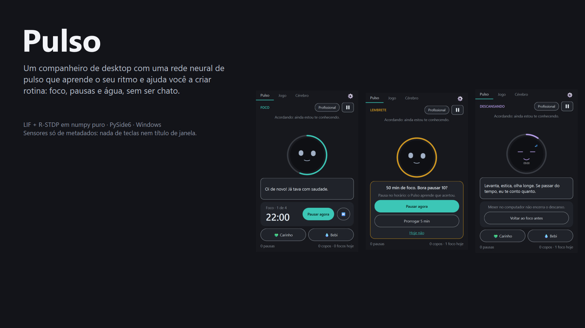
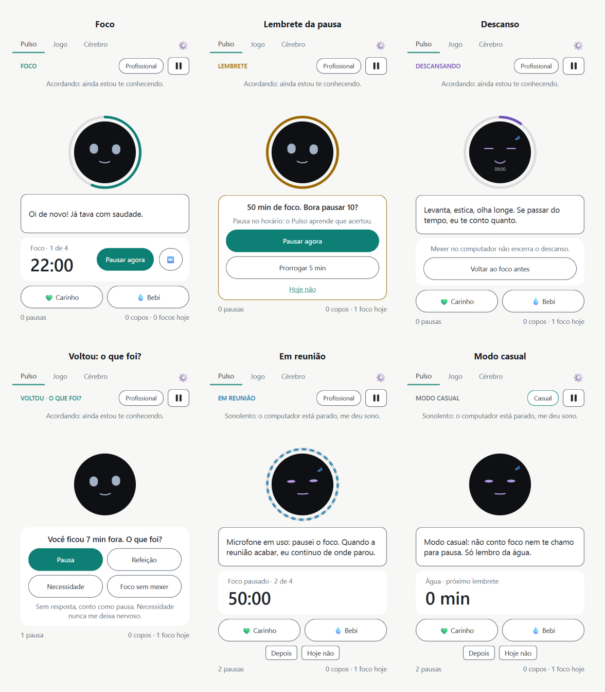
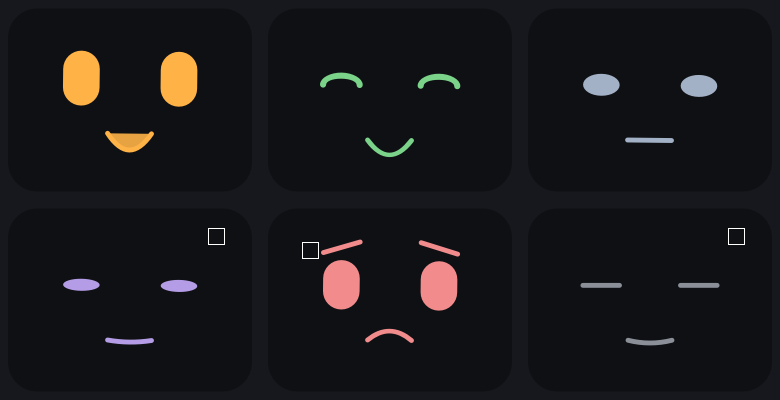
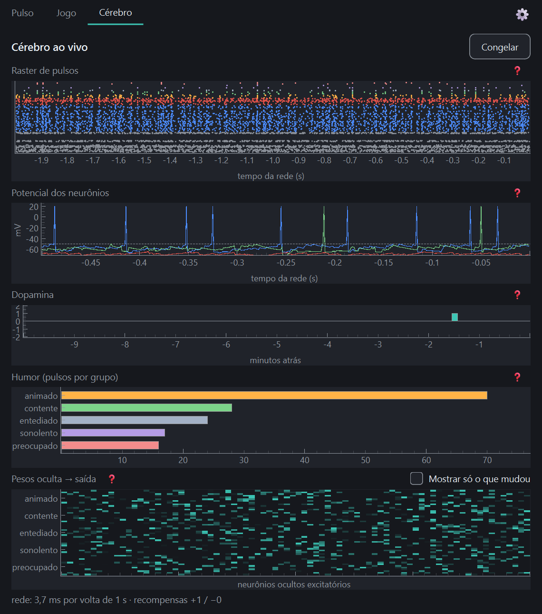
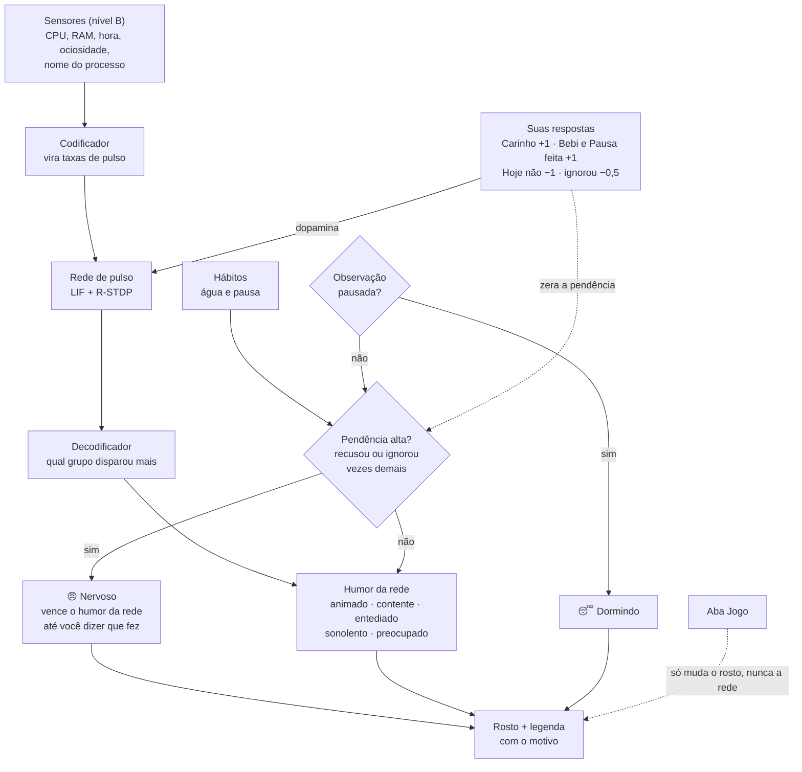

# Pulso

[](https://github.com/AndreiBataglia/pulso/actions/workflows/ci.yml)


[](LICENSE)



**Status: em construção.** Já funcionam: os sensores, a rede que aprende, o pet na janela, a aba do cérebro,
hábitos (foco por presença, pausas e água), bandeja do Windows, ajustes e um jogo. A etapa 7 (*O momento certo*)
está em andamento: o ciclo do foco e a janela nova já existem; faltam o humor por regras e a rede decidir *quando*
lembrar. Depois vêm a aba de saúde, o atalho global e o instalador.

## English

Pulso is a Windows desktop companion driven by a small spiking neural network
(leaky integrate-and-fire neurons with reward-modulated STDP, written in plain numpy).
It learns your rhythm from coarse signals only (CPU, RAM, time, idle time, foreground process name),
and helps you build routine: a focus cycle that starts by itself when you are at the PC, break reminders
and water reminders. It never reads keystrokes or window titles.

## Português

Pulso é um companheiro de desktop para Windows, movido por uma pequena rede neural de pulso
(neurônios LIF com R-STDP, em numpy puro). Ele aprende o seu ritmo a partir de sinais grosseiros
e ajuda você a criar rotina: foco, pausas e água. O projeto também é um diário de aprendizado: cada etapa
explica os conceitos usados em [`docs/diario/`](docs/diario/).

## Como o Pulso ajuda

O foco é **criar rotina sem ser chato**. O pet pergunta, você responde; ele nunca bloqueia nem controla a tela.



- **O foco começa sozinho.** Não existe botão *Iniciar*: quando você mexe no PC, o foco abre (50 min por padrão) e o
  anel em volta do rosto mostra o andamento. A pílula **Profissional / Casual** troca o modo.
- **Lembrete da pausa.** Ao fim do foco: **Pausar agora**, **Prorrogar 5 min** ou **Hoje não**. Pausa no horário
  deixa o pet contente; recusar ou ignorar soma pendência e o deixa nervoso.
- **Descanso.** O rosto descansa com a contagem. Se passar do combinado, ele só conta quanto, sem bronca.
- **"O que foi?"** Quando você volta de uma ausência, o Pulso pergunta: *pausa*, *refeição*, *necessidade* ou
  *foco sem mexer*. Refeição e necessidade nunca o deixam nervoso, e sem resposta conta como pausa.
- **Reunião.** Microfone em uso por outro programa **pausa** o foco, sem penalizar, e ele continua de onde parou.
  A câmera e o microfone nunca são usados como sensor de presença.
- **Modo casual.** Sem ciclo de foco: só o lembrete de água.
- **Água.** *Bebi* faz o pet beber com você. O placar do dia fica no rodapé (pausas, prorrogações, copos, focos).
- **Você manda nos tempos.** Em **Ajustes** (⚙ ou menu da bandeja): foco, descansos, intervalo da água, modo e
  quanto tempo parado conta como ausente.
- **O pet vive na bandeja do Windows**, com avisos, pode iniciar com o Windows (abrindo só na bandeja), ficar
  sempre à frente e ser reaberto pelo Menu Iniciar. Sair de vez é pelo ícone da bandeja.
- **Um jogo para o dia a dia.** Na aba **Jogo**, jokenpô e par ou ímpar: se o pet ganha, fica contente; se perde,
  fica bravo. O resultado muda só o rosto e o placar, nunca a rede.

## A rede de pulso

O pet aprende com o que **você** responde (carinho e as respostas aos lembretes), não com palpites. As regras que
tiravam conclusões do programa em uso ficam desligadas por padrão (dá para ligá-las em Ajustes).



A aba **Cérebro** mostra a rede por dentro: raster de pulsos, potenciais, dopamina, humor e mapa de pesos.



### Como o humor funciona

O rosto mostra **um humor por vez**, e a legenda embaixo diz o que ele significa. Hoje a ordem de prioridade é:



- **A rede decide o humor de base**, e ela aprende com o que **você** responde (setas de dopamina).
- **Nervoso vence a rede.** Recusar ou ignorar lembretes soma pendência; só um *fiz* a zera (*depois* vale 0). O
  balão diz o motivo: água, pausa ou as duas.
- **Pausar a observação** põe o pet para dormir e congela o foco.
- **Refeição e necessidade** (a pergunta "o que foi?") nunca somam pendência, e a rede só aprende com pausa e foco.
- **Ainda não feito (fatia 4):** o humor passa a seguir regras explicáveis (cumpriu → contente, pendência → nervoso,
  muito tempo sem interação → sonolento) e a rede passa a decidir *quando* lembrar (fatia 5).

*In English:* the window has one panel per phase (focus, break reminder, rest, "what happened?" after an absence,
meeting, casual mode). The network learns from your own answers; the process-based guesses are off by default.
A microphone in use by another program pauses focus without penalty. Timers, mode and the away tolerance are
configurable in Settings, the pet lives in the tray, and a small rock-paper-scissors / odds-and-evens game
changes only its face, never the network.

## Privacidade

Os sensores leem apenas metadados: CPU, RAM, hora, ociosidade e o **nome do processo** em primeiro plano.
O título da janela, o conteúdo da tela e as teclas **nunca** são lidos. Existe uma pausa de
privacidade que desliga os sensores (o foco congela junto, porque sem leitura não há como saber se você está lá).
Dados de sensor não são gravados em disco nem no log.

## Instalação (desenvolvimento)

```powershell
python -m venv .venv
.venv\Scripts\activate
pip install -e ".[dev]"
pulso --version
pytest
pulso --criar-atalho   # cria o atalho "Pulso" no Menu Iniciar (para abrir de novo depois de sair)
```

Para ver o app sem mexer nos seus dados e sem ler sensores de verdade:

```powershell
$env:PULSO_DATA_DIR = "$env:TEMP\pulso-teste"; pulso --fake-sensors
```

Para sair de vez: botão direito no ícone da bandeja → **Sair do Pulso**. O X da janela só manda para a bandeja.

## Documentação

Veja [`docs/README.md`](docs/README.md): PRD, TRD, fluxo, design, dados e plano de implementação.

## Licença

[MIT](LICENSE)
