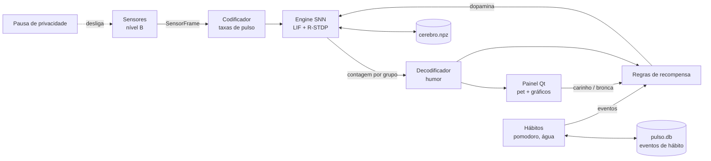

# TRD — Pulso

> Documento de Requisitos Técnicos: **com o quê** vamos construir e **por quê**.
> É a referência para qualquer decisão técnica: se algo não estiver aqui, decida, registre aqui e siga.
> Última revisão: 2026-11-06

## 1. Visão geral da arquitetura
Um único programa Python, local, com um **laço de 1 segundo**:
1. os sensores leem os metadados do PC;
2. o codificador transforma as leituras em **taxas de pulso**;
3. o motor SNN simula 100 ms de rede;
4. a cada 10 s, o decodificador escolhe o humor;
5. as regras e o dono enviam recompensas, que viram dopamina;
6. a interface desenha o pet e os gráficos.

Os lembretes de hábito (pomodoro e água) são **relógios com regras fixas**, separados do cérebro. Eles só
mandam eventos (lembrete atendido ou dispensado) que viram recompensa.



## 2. Stack
| Camada | Escolha | Por quê | Alternativa descartada |
|--------|---------|---------|------------------------|
| Linguagem | Python ≥ 3.12 (desenvolvido em 3.13) | O dono já usa; ecossistema científico | — |
| Interface | **PySide6** (Qt 6) | Painel com abas, bandeja e notificações nativas; licença LGPL compatível com MIT | Tkinter (fraco para gráficos em tempo real e bandeja) |
| Gráficos do cérebro | **pyqtgraph** | Desenha milhares de pontos por segundo dentro do Qt | matplotlib (lento para tempo real) |
| SNN | **numpy puro**, escrito por nós | Didático (cada equação fica visível) e leve para ~200 neurônios | Brian2 (esconde o funcionamento; vira F16) · snnTorch (treino offline por gradiente, outro paradigma; vira F15) |
| Sensores (Windows) | **psutil** + **ctypes** (Win32) | psutil dá CPU, RAM e o nome do processo; ctypes chama `GetForegroundWindow`, `GetLastInputInfo` e `RegisterHotKey` sem dependência extra | pywin32 (pesado para 3 funções) · `keyboard`/`pynput` (instalam *hook* global de teclado, o que contraria a privacidade) |
| Armazenamento | `.npz` (pesos) + **SQLite** (eventos de hábito) + **TOML** (configuração) | Tudo arquivo local, sem servidor | Banco servidor (desnecessário) |
| Empacotamento | `pyproject.toml` (setuptools), comando `pulso` | Padrão moderno; `pip install -e .` | requirements.txt solto |
| Hospedagem do código | **GitHub público**, licença MIT, CI no GitHub Actions | Decisão do dono | — |

## 3. Bibliotecas e ferramentas
| Nome | Para quê | Usada em |
|------|----------|----------|
| numpy | Simulação da rede | F03, F04 |
| PySide6 | Janela, abas, bandeja, notificações | F05–F10 |
| pyqtgraph | Raster, potenciais, dopamina, pesos | F06, F09 |
| psutil | CPU, RAM, nome do processo pelo PID | F01 |
| platformdirs | Pasta de dados do usuário (`%LOCALAPPDATA%\Pulso`) | F04, F09, F10 |
| tomli-w | Gravar a configuração TOML (a leitura usa `tomllib`, da biblioteca padrão) | F10 |
| pytest | Testes | todas |
| ruff | *Lint* e formatação | todas |
| gh (GitHub CLI) | Criar o repositório, abrir PRs, criar releases | F11 |

## 4. APIs e integrações externas
Nenhuma. O programa não acessa a internet. As únicas "APIs" são as do Windows, chamadas por ctypes:
- `GetForegroundWindow` + `GetWindowThreadProcessId`: PID do programa em primeiro plano. O nome do processo vem
  do psutil. **`GetWindowText` (título) nunca é chamado.**
- `GetLastInputInfo`: tempo desde a última entrada de teclado/mouse, sem saber qual tecla.
- `RegisterHotKey`: atalho global de pausa. O Windows avisa só quando aquela combinação é apertada; não é
  *hook*. Como receber o `WM_HOTKEY` dentro do Qt (`QAbstractNativeEventFilter` com o `winId()` da janela)
  **será validado na etapa 7**.

## 5. Estrutura de pastas e convenções
```
projeto_tamagotchi/
├── pyproject.toml          # dependências, comando `pulso`, config do ruff e do pytest
├── README.md               # vitrine do GitHub: o que é, captura, instalação, como funciona, etapas
├── LICENSE                 # MIT
├── CHANGELOG.md            # uma entrada por etapa/versão (formato Keep a Changelog)
├── CLAUDE.md               # instruções para o agente
├── .gitignore              # .venv, __pycache__, dados do usuário, logs
├── .github/workflows/ci.yml  # testes + ruff no windows-latest a cada push e PR
├── docs/
│   ├── README.md           # índice dos documentos
│   ├── 01-prd.md … 06-implementation-plan.md
│   ├── diario/             # etapa-00.md, etapa-01.md…: o que foi feito, conceitos, como testar
│   └── img/                # capturas para o README e o diário
├── src/pulso/
│   ├── app.py              # ponto de entrada: monta tudo e inicia o Qt
│   ├── loop.py             # laço mínimo de 1 s: lê o sensor (com a pausa de privacidade)
│   ├── controller.py       # PetController: sensor → rede → humor → recompensas → gravação (sem Qt)
│   ├── clock.py            # relógio injetável (real ou falso, para testes)
│   ├── sensors/
│   │   ├── base.py         # SensorFrame (dataclass) e protocolo Sensor
│   │   ├── windows.py      # leitura real via psutil + ctypes
│   │   ├── categories.py   # tabela processo → categoria
│   │   └── fake.py         # sensor roteirizado para testes e para rodar sem Windows
│   ├── brain/
│   │   ├── engine.py       # interface Engine (o contrato trocável)
│   │   ├── numpy_engine.py # LIF + R-STDP em numpy
│   │   ├── encoding.py     # SensorFrame → vetor de taxas de pulso
│   │   ├── decoding.py     # contagem por grupo → humor (com histerese)
│   │   └── rewards.py      # regras automáticas + recompensa do dono → dopamina
│   ├── habits/
│   │   ├── pomodoro.py     # máquina de estados foco/descanso
│   │   └── water.py        # intervalo, adiar, contar copos
│   ├── storage/
│   │   ├── paths.py        # pastas (platformdirs)
│   │   ├── brain_store.py  # salvar/carregar o cérebro (.npz com versão)
│   │   ├── db.py           # SQLite dos eventos de hábito
│   │   └── config.py       # configuração TOML com valores padrão e validação
│   └── ui/
│       ├── app.py          # monta tudo (cérebro novo ou salvo, tema) e abre a janela
│       ├── theme.py        # paleta clara/escura e conferência de contraste
│       ├── phrases.py      # falas do pet
│       ├── main_window.py  # janela com abas e o QTimer de 1 s
│       ├── pet_widget.py   # desenho e animação do pet (QPainter)
│       ├── brain_tab.py    # gráficos pyqtgraph
│       ├── health_tab.py   # resumo de saúde
│       ├── settings_dialog.py
│       ├── tray.py         # ícone da bandeja e notificações
│       └── hotkey.py       # atalho global (RegisterHotKey)
└── tests/                  # espelha src/pulso/
```
- **Padrões de código:** identificadores em **inglês** (alcance no GitHub); **comentários, docstrings e
  documentação em português**. Código de alto nível e bem comentado, explicando o porquê de cada equação. Ruff
  como *lint* e formatador (linha de 100, como no `pyproject.toml`).
- **Regras de arquitetura:**
  - `brain/`, `habits/`, `controller.py`, `sensors/base.py` e `storage/` **não importam Qt**, para que possam ser testados sem
    interface.
  - Só `ui/` importa PySide6 e pyqtgraph.
  - Só `sensors/windows.py` chama a API do Windows.
  - Tudo que depende de tempo recebe um `Clock`, e nunca chama `time.time()` direto.

### 5.1 O cérebro (desenho do MVP)
| Camada | Neurônios | Tipo | Observação |
|--------|-----------|------|------------|
| Entrada | 63 | Geradores de Poisson (não são LIF) | Cada sensor normalizado em [0, 1] vira taxa de 0–100 Hz. Categoria e faixa de hora usam grupos *one-hot* (um grupo por valor) |
| Oculta | 100 | LIF (80 excitatórios + 20 inibitórios) | Conexões esparsas (~20%) |
| Saída | 50 | LIF, 5 grupos de 10 (um por humor) | Inibição lateral entre os grupos (o mais forte "cala" os outros) |

- **LIF:** τm = 20 ms, V repouso = −65 mV, limiar = −50 mV, reset = −65 mV, refratário = 2 ms, Euler com
  dt = 1 ms.
- **R-STDP (regra de três fatores):** rastros pré e pós (τ = 20 ms) geram o STDP clássico. O resultado não
  muda o peso na hora: vai para um **rastro de elegibilidade** `e`. Quando chega a dopamina,
  `Δw = η · d · e`.
  - A dopamina é `d = r − r̄`: recompensa menos a média recente, uma aproximação do "erro de previsão".
  - Pesos limitados a [0, w_max] e normalizados, para a rede não "explodir": na oculta→saída a soma é
    mantida **por neurônio que manda** (reforçar um humor tira dos outros); na entrada→oculta, por neurônio
    que recebe.
  - A elegibilidade é dividida pelo seu RMS na hora da dopamina: cada recompensa move um orçamento de peso
    parecido, e o contexto que faz a rede disparar mais não leva todo o reforço.
  - **Plástica por padrão: só a oculta→saída** (`η = 0,05`). A entrada→oculta tem o mecanismo pronto, mas
    fica congelada (`η = 0`): nos experimentos da etapa 3, punir essa camada silenciava o contexto punido
    (diário `etapa-03.md`). Limitação conhecida: 1 de 6 sementes testadas não aprendeu o cenário de teste.
- **⚠ Dois relógios:** a rede simula 100 ms a cada 1 s real (10× mais devagar que o tempo real). Constantes
  que dependem da **recompensa** (τ da elegibilidade) são definidas em **tempo de rede**. Assim,
  τe = 1 s de rede ≈ 10 s reais, o bastante para o carinho que chega alguns segundos depois do humor ainda
  "achar" as sinapses certas.
- **Decodificação:** a cada 10 s o grupo com mais pulsos vence. Uma **histerese** (o novo humor precisa vencer
  com margem) evita trocas nervosas.
- **Custo estimado:** ~150 LIF × 100 passos por segundo, com multiplicação matriz-vetor 210×150: bem abaixo
  de 5 ms por segundo. **Medido: 1,6 ms por segundo real na etapa 2 e 2,7 ms na etapa 3 (com aprendizado), então não precisa de
  thread; um teste falha se passar de 20 ms.**

### 5.2 O contrato trocável (`Engine`)
```python
class Engine(Protocol):
    """Qualquer cérebro que aprende ONLINE (enquanto roda) pode ser trocado por este contrato."""
    n_inputs: int
    groups: list[str]                                   # nomes dos grupos de saída (os humores)

    def step(self, rates_hz: np.ndarray, duration_ms: int) -> StepResult: ...   # contagem de pulsos por grupo
    def reward(self, value: float) -> float: ...        # dopamina; devolve d = r − r̄ (para o gráfico)
    def snapshot(self) -> BrainSnapshot: ...            # dados para os gráficos (pulsos recentes, V, d, pesos): cópias, sem mexer na rede
    def state_dict(self) -> dict[str, np.ndarray]: ...  # o que salvar
    def load_state_dict(self, state: dict[str, np.ndarray]) -> None: ...
```
- **O contrato cresce por etapas:** na etapa 2 tem `step`, `state_dict` e `load_state_dict`; `reward` entra na
  etapa 3 e `snapshot` na 5 (e `reward` passou a devolver a dopamina). O teste de contrato acompanha cada acréscimo.
- **`snapshot()` e a memória dos gráficos:** o motor numpy grava, a cada ms de rede, os pulsos de todos os neurônios e o
  potencial de 3 deles num registro circular de 2 s de rede (≈ 20 s reais, ~430 KB). Não vai para o disco. A aba só
  pede a fotografia quando está visível e descongelada.
- O codificador, o decodificador e as regras **ficam fora** do motor: trocar o motor não mexe neles.
- Um teste de contrato (`tests/brain/test_engine_contract.py`) roda **qualquer** `Engine` contra os mesmos
  cenários. Um motor novo só é aceito se passar nele.
- **Limite honesto:** motores treinados **offline** por gradiente (snnTorch/Norse) não cabem neste contrato
  sozinhos. Precisam de um modo de treino separado (F15).

## 6. Configuração e segredos
- **Não há segredos:** sem chaves, sem login, sem rede.
- `config.toml` na pasta de dados (`%LOCALAPPDATA%\Pulso\`) guarda: intervalos do pomodoro e da água, tabela de
  categorias extra, atalho de pausa, pesos das recompensas, tamanho da rede e iniciar com o Windows.
- Os valores padrão ficam em `storage/config.py`. Um arquivo ausente ou inválido volta ao padrão, com aviso
  no log.
- Variável `PULSO_DATA_DIR` para trocar a pasta de dados (usada nos testes e em demonstrações).

## 7. Ambientes e execução
- **Desenvolvimento:** `python -m venv .venv` → `.venv\Scripts\pip install -e ".[dev]"` → `pulso` (ou
  `python -m pulso`). `pulso --fake-sensors` roda com o sensor roteirizado, sem ler o PC.
- **Uso real:** `pip install` a partir do GitHub. Opção "iniciar com o Windows" (atalho na pasta Inicializar).
  Um executável (PyInstaller) fica para depois do MVP.

## 8. Segurança e privacidade
- Sem porta de rede aberta e sem acesso à internet.
- Sensores restritos ao nível B (PRD F01). O título da janela e o conteúdo digitado nunca são lidos.
- Pausa de privacidade: os sensores **param de ser chamados** (não é só esconder). Um teste verifica que, na
  pausa, o sensor não recebe nenhuma chamada.
- Dados brutos de sensor vivem só na memória. Em disco ficam apenas os pesos da rede e os eventos de hábito.
- O `.gitignore` bloqueia `*.npz`, `*.db`, `logs/` e `data/`. Os testes usam pasta temporária e sensor falso:
  **nunca tocam os dados reais do dono**.

## 9. Testes e qualidade
- **pytest**, com testes antes do código em cada etapa.
  - Unitários: LIF (frequência de disparo esperada para uma corrente conhecida), STDP (pré antes de pós
    fortalece), R-STDP (sem dopamina, o peso não muda), pomodoro e água com relógio falso, categorias,
    configuração.
  - Contrato do `Engine` (§5.2).
  - Aprendizado: um cenário roteirizado em que, depois de N recompensas, o humor recompensado passa a vencer.
  - Privacidade: na pausa o sensor não é chamado; a palavra `GetWindowText` não aparece no código (teste de
    grep).
  - Interface: poucos testes, com `QT_QPA_PLATFORM=offscreen`.
- **Teste real em cada etapa:** rodar o programa, conferir onde gravou os arquivos e apagar o lixo do teste.
- **CI:** GitHub Actions no `windows-latest`, com Python 3.12 e 3.13, rodando `ruff check` e `pytest` em todo
  push e PR.

## 10. Logs, erros e monitoramento
- `logging` padrão, com arquivo rotativo em `%LOCALAPPDATA%\Pulso\logs\pulso.log` (5 arquivos de 1 MB).
- **Nunca** registrar nome de processo nem leitura de sensor no log; só eventos (pausou, salvou o cérebro,
  erro).
- Um erro num sensor não derruba o programa: aquela leitura vira "desconhecida" e o laço segue.
- A aba do cérebro mostra o tempo de cada passo (orçamento de CPU visível).

## 11. Fluxo de trabalho no Git e no GitHub
- Repositório **público**, criado com `gh repo create` depois que o dono instalar e autenticar o `gh` (etapa 0).
- **Uma branch por etapa** (`etapa-03-rstdp`), com commits pequenos e lógicos no padrão *Conventional Commits*
  (`feat:`, `fix:`, `docs:`, `test:`), em português.
- Fim de etapa:
  1. Diário em `docs/diario/etapa-NN.md`.
  2. Entrada no `CHANGELOG.md` e marcação `[x]` no plano (doc 06).
  3. PR para `main` com CI verde e *merge*.
  4. Tag `v0.N.0` e *release* no GitHub.
- **Commit, push, PR e tag só com autorização explícita do dono, a cada vez.**

## 12. Suposições
- Uma thread só (laço no `QTimer` do Qt) enquanto a medição couber no orçamento (§5.1).
- Pet desenhado com QPainter (fundo escuro, olhos, boca e pequenos emojis) no MVP, sem arquivos de imagem; pixel art no F17.
- Identificadores em inglês e comentários em português.
- Python ≥ 3.12.

## 13. Perguntas em aberto
- Receber o `WM_HOTKEY` no Qt: a ser validado na etapa 7. O plano B é uma thread com laço de mensagens próprio.
- Os parâmetros da rede (η, τe, tamanho) serão ajustados por experimento nas etapas 2 e 3; os valores acima são
  pontos de partida da literatura.

## Histórico de revisões
| Data | Mudança |
|------|---------|
| 2026-11-05 | Versão inicial |
| 2026-11-06 | Etapa 3: só a oculta→saída aprende, normalizações, elegibilidade pelo RMS, custo 2,7 ms |
| 2026-11-06 | Etapa 2: 63 entradas, contrato `Engine` por etapas, custo medido, linha de 100 colunas |
