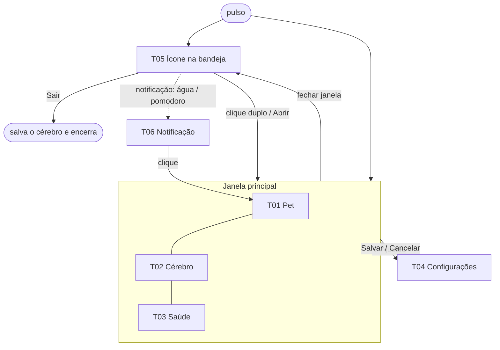
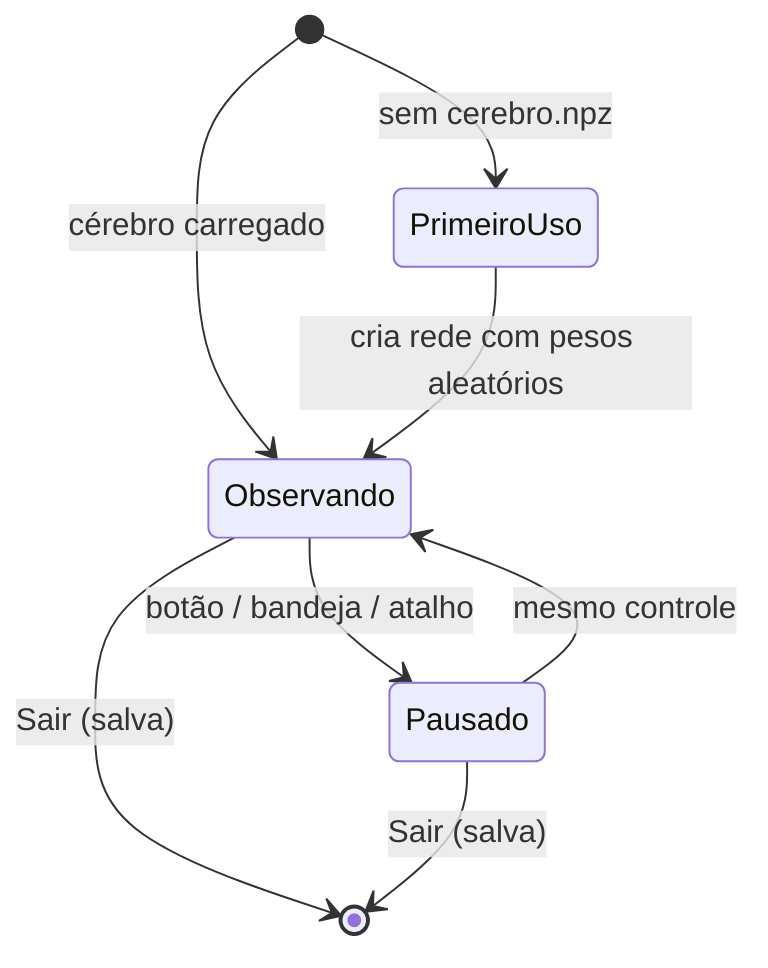

# App Flow — Pulso

> Mapa da navegação e da jornada do usuário: quais telas existem, como se chega nelas
> e **o que acontece ao clicar em cada ação**.
> Última revisão: 2026-11-05

## 1. Mapa de navegação

## 2. Fases / estados do app

- **Primeiro uso:** não há cérebro salvo. O pet aparece "recém-nascido": a fala explica que ele vai aprender com
  carinho e bronca. As regras automáticas já dão um comportamento mínimo.
- **Observando:** laço de 1 s ativo; humor atualizado a cada 10 s.
- **Pausado (privacidade):** sensores parados, aprendizado parado, pet "dormindo" com um selo **"Observação
  pausada"**. O pomodoro e a água **continuam** (são relógios, não observação).
- O **pomodoro** tem o próprio ciclo (parado → foco → descanso → foco…), independente dos estados acima.

## 3. Telas

### T01 — Pet (aba inicial)
- **Objetivo:** ver e interagir com o companheiro.
- **Funcionalidades:** F02, F04, F05, F07, F08
- **Como se chega:** é a aba que abre por padrão; também ao clicar numa notificação.
- **Conteúdo:**
  - o desenho do pet com o humor atual e uma frase;
  - o contador do pomodoro;
  - os copos de água de hoje;
  - um indicador "👁 observando" ou "😴 pausado".
- **Ações:**

| Ação | O que acontece | Próxima tela | Em caso de erro |
|------|----------------|--------------|-----------------|
| 💚 Carinho | Recompensa +1 (dopamina); o pet faz uma animação de alegria | T01 | — |
| 💢 Bronca | Recompensa −1; o pet faz uma animação de "ops" | T01 | — |
| 👁 Pausar observação | Sensores e aprendizado param; o pet dorme | T01 (estado pausado) | — |
| ▶ Retomar observação | Volta a observar | T01 | Se o sensor falhar, mostra o aviso "sensor indisponível" e segue com leitura desconhecida |
| 🍅 Iniciar / Pausar / Pular pomodoro | Controla o ciclo (F07) | T01 | — |
| 💧 Bebi | +1 copo; o lembrete reinicia o intervalo; recompensa "lembrete atendido" | T01 | — |
| ⏰ Depois | Adia o lembrete 10 min; recompensa "dispensado" (−, leve) | T01 | — |

- **Estados especiais:**
  - primeiro uso: fala de boas-vindas;
  - pausado: pet dormindo e selo visível;
  - lembrete ativo: balão de fala com os botões Bebi / Depois.

### T02 — Cérebro
- **Objetivo:** ver a rede funcionando (aprender vendo).
- **Funcionalidades:** F03, F04, F06
- **Conteúdo:**
  1. Raster de pulsos dos últimos ~2 s de rede (eixo y: neurônio, colorido por camada).
  2. Potencial de membrana de 3 neurônios escolhidos.
  3. Curva da dopamina, com marcas de cada recompensa e sua fonte (dono ou regra).
  4. Barras com a contagem por grupo de saída (qual humor está vencendo).
  5. Mapa de calor dos pesos oculta→saída.
  6. Rodapé com o tempo por passo (ms) e o total de recompensas positivas e negativas.
- **Ações:**

| Ação | O que acontece | Próxima tela | Em caso de erro |
|------|----------------|--------------|-----------------|
| Congelar / Continuar gráficos | Para de redesenhar (a rede continua rodando) | T02 | — |
| Escolher neurônio (lista) | Troca qual potencial é mostrado | T02 | — |
| ❓ (ícone de ajuda em cada gráfico) | Abre uma dica curta explicando o gráfico, com link para o diário | T02 | — |

- **Estados especiais:** pausado → os gráficos param com a legenda "observação pausada". Aba fora de foco ou
  janela minimizada → não redesenha (F06).

### T03 — Saúde
- **Objetivo:** resumo dos hábitos.
- **Funcionalidades:** F07, F08, F09
- **Conteúdo:**
  - hoje: copos de água, pomodoros concluídos, maior sequência sem pausa;
  - gráfico de barras dos últimos 7 dias;
  - aviso "lembretes de hábito, não é orientação médica".
- **Ações:** nenhuma no MVP, só leitura.
- **Estados especiais:** sem dados → "Ainda não há registros. Beba um copo d'água e volte aqui 🙂".

### T04 — Configurações (diálogo)
- **Objetivo:** ajustar o comportamento.
- **Funcionalidades:** F10, F01, F02, F04, F07, F08
- **Como se chega:** botão ⚙ na janela principal ou pelo menu da bandeja.
- **Conteúdo:**
  - pomodoro (foco, descanso e descanso longo, em minutos);
  - água (intervalo e adiamento);
  - atalho de pausa;
  - pesos das recompensas (dono e regras);
  - tabela de categorias: processo → categoria, com acrescentar e remover;
  - iniciar com o Windows;
  - zona de perigo: "Recomeçar cérebro do zero".
- **Ações:**

| Ação | O que acontece | Próxima tela | Em caso de erro |
|------|----------------|--------------|-----------------|
| Salvar | Valida e grava o `config.toml`; aplica na hora | Janela principal | Valor fora do limite → mensagem no campo e não salva |
| Cancelar | Descarta as mudanças | Janela principal | — |
| Recomeçar cérebro | Pede confirmação, guarda o cérebro atual como `cerebro_bkp_<data>.npz` e cria um novo | T04 | Falha ao salvar o backup → não apaga e avisa |
| Atalho de pausa (campo) | Captura a combinação e testa o registro | T04 | Combinação já usada por outro app → "esse atalho está ocupado, escolha outro" |

### T05 — Ícone na bandeja
- **Menu:**
  - Abrir;
  - Pausar / Retomar observação;
  - Pomodoro (iniciar, pausar, pular);
  - Ajustes;
  - Sair.
- O ícone muda conforme o estado: normal, pausado, descanso.
- Fechar a janela principal **não** encerra: ela fica na bandeja. Na primeira vez, aparece uma notificação
  explicando isso.

### T06 — Notificação do Windows
- Avisos de "hora da água", "hora do descanso" e "hora de voltar".
- Clicar abre T01 com o balão do lembrete. O tom é o do pet ("Psiu! Um gole d'água? 💧").

## 4. Jornadas principais

### J01 — Primeiro uso
1. O dono roda `pulso`. Não há cérebro salvo: o programa cria a pasta de dados, a rede nova e a configuração
   padrão.
2. T01 mostra o pet recém-nascido, com a fala de boas-vindas que explica carinho, bronca e pausa.
3. Os sensores começam. Em ~10 s aparece o primeiro humor, escolhido pelas regras e pelo acaso da rede.
4. Resultado: o pet está vivo, e a bandeja mostra o ícone.

### J02 — Momento sensível
1. O dono vai abrir algo pessoal e aperta o atalho (ou o botão, ou a bandeja).
2. Os sensores param na hora; o pet dorme; o selo "Observação pausada" aparece; o ícone da bandeja muda.
3. Depois, o dono aperta o mesmo controle. A observação volta e o pet acorda.

### J03 — Ensinar o pet
1. O dono volta do almoço. Os sensores veem o fim do ócio, e o pet fica "animado". A regra dá +, e o dono
   também clica 💚.
2. Mais tarde o pet fica "entediado" enquanto o dono programa concentrado. O dono clica 💢.
3. Em T02, ele vê a dopamina subir e descer e os pesos mudarem. Em alguns dias, o humor passa a acompanhar o
   gosto dele.

### J04 — Pomodoro e água
1. O dono clica 🍅 Iniciar. Depois de 25 min, chega a notificação "hora do descanso", e o pet se espreguiça.
2. No meio do descanso, o lembrete de água aparece. O dono clica 💧 Bebi: +1 copo e recompensa "atendido".
3. Depois de 5 min, chega "hora de voltar". À noite, T03 mostra 6 copos e 8 pomodoros.

## 5. Suposições
- A janela principal tem tamanho fixo moderado (~520×640) e pode ser redimensionada.
- Carinho e bronca sem limite de cliques. As regras de recompensa ignoram cliques repetidos em menos de 2 s
  (para não "viciar" a rede).

## 6. Perguntas em aberto
- O pomodoro deve começar sozinho no primeiro uso do dia, ou sempre manual? (Suposição: manual.)

## Histórico de revisões
| Data | Mudança |
|------|---------|
| 2026-11-05 | Versão inicial |
