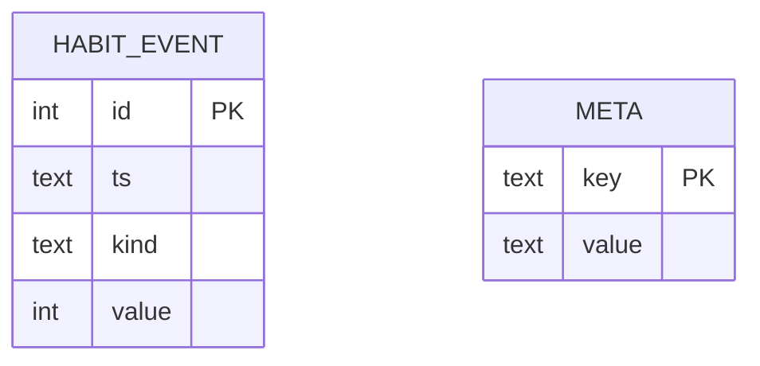

# Esquema de Back-end — Pulso

> Como os dados são **guardados, organizados e protegidos**.
> Última revisão: 2026-11-06 (etapa 3: nomes reais das chaves)

## 1. Visão geral do armazenamento
Não há servidor nem login: tudo fica em **3 arquivos locais** na pasta de dados do usuário
(`%LOCALAPPDATA%\Pulso\`, ou a pasta definida em `PULSO_DATA_DIR`):

| Arquivo | O que guarda | Formato | Usado por |
|---------|--------------|---------|-----------|
| `config.toml` | Preferências do dono | TOML | F01, F02, F04, F07, F08, F10 |
| `cerebro.npz` | O que o Pulso **aprendeu** (pesos e estado da rede) | numpy `.npz` | F03, F04 |
| `pulso.db` | Eventos de **hábito** (água, pomodoro) | SQLite | F07, F08, F09 |
| `logs/pulso.log` | Eventos técnicos, sem dados de sensor | texto rotativo | todos |

**O que nunca é gravado:** leituras de sensor (CPU, RAM, processo, categoria, ociosidade), linha do tempo de
humores, nomes de programas usados. Esses dados existem só na memória, no laço de 1 s. Assim a decisão em
aberto "histórico em disco ou só pesos" fica resolvida: **só pesos e eventos de hábito**.

## 2. Autenticação e autorização
Não se aplica. O programa é de um usuário só e não abre rede. A proteção vem da pasta de usuário do Windows.

## 3. `cerebro.npz`
| Chave | Forma | Descrição |
|-------|-------|-----------|
| `format_version` | escalar int | Versão do formato (começa em 1); carregador recusa versão desconhecida com aviso |
| `engine` | string | Nome do motor (`numpy_lif_rstdp`); trocar de motor não reaproveita pesos de outro |
| `groups` | (5,) string | Ordem dos humores nos grupos de saída |
| `w_in_hidden` | (n_in, n_hid) float64 | Pesos entrada→oculta (mecanismo plástico; congelado por padrão) |
| `w_hidden_hidden` | (n_hid, n_hid) float64 | Recorrência da oculta (fixa no MVP) |
| `w_hidden_out` | (n_hid, n_out) float64 | Pesos oculta→saída (plásticos) |
| `w_out_out` | (n_out, n_out) float64 | Inibição lateral entre os humores (fixa) |
| `mask_in_hidden`, `mask_hidden_out` | mesmas formas, bool | Quais conexões plásticas existem (esparsidade) |
| `reward_baseline` | escalar float | Média recente das recompensas (r̄) |
| `seed` | escalar int | Semente que gerou a rede (reprodutibilidade) |
| `stats` | (3,) int64 | Total de recompensas positivas, negativas e de passos simulados (ms de rede) |
| `saved_at` | string ISO | Quando salvou |

- Potenciais de membrana e rastros **não** são salvos: zeram ao abrir, como "acordar".
- Gravação **atômica**: escreve `cerebro.npz.tmp` e depois renomeia, para não corromper se faltar energia.
- Salvamento a cada 5 min, ao pausar e ao sair.

## 4. `pulso.db` (SQLite)


### habit_event
**Para quê:** cada acontecimento de hábito · **Usada por:** F07, F08, F09, T03

| Coluna | Tipo | Obrigatória | Padrão | Descrição / regras |
|--------|------|-------------|--------|--------------------|
| id | INTEGER | sim | auto | Chave primária |
| ts | TEXT | sim | agora | Data e hora local, formato ISO 8601 |
| kind | TEXT | sim | — | Um de: `water_drunk`, `water_snoozed`, `water_declined`, `water_ignored`, `pomodoro_focus_done`, `pomodoro_break_done`, `break_snoozed`, `break_declined`, `break_ignored`, `pomodoro_skipped`, `break_streak_end` |
| value | INTEGER | não | NULL | Dado extra; em `break_streak_end` são os minutos de trabalho seguidos antes da pausa |

- **Índice:** `ts` (consultas de "hoje" e "últimos 7 dias").
- **Feito na etapa 6 (decisão do dono, 2026-11-06):** **fiz / adiei / recusei / ignorei** para água e pausa. "Fiz" =
  `water_drunk` e `pomodoro_break_done`; `pomodoro_skipped` é o dono pulando a fase pelo painel (não é recusa).
  A **pendência cumulativa** que deixa o Pulso nervoso não é guardada: é calculada destes eventos (recusas e omissões
  depois do último "fiz" **do mesmo hábito**; água e pausa são separadas). `break_streak_end` só é gravado na etapa 7.
- `CHECK (kind IN (...))` garante os valores permitidos.

**Migração v3 (etapa 7, ciclo do foco por presença):** o SQLite não altera um `CHECK`, então a tabela é refeita e os
eventos antigos são copiados (os `id` seguem). Entram:

| Coluna / tipo | Descrição |
|---|---|
| `kind` = `away_need`, `away_focus` | Respostas de "o que foi?" que não são pausa: **necessidade** (não penaliza, o foco segue) e **foco sem mexer** (o tempo fora vira foco) |
| `category` TEXT, `CHECK` em `pause`, `meal`, `need`, `focus` | A resposta de "o que foi?" (as 4 categorias). Uma pausa pelo lembrete grava `pause` |
| `planned_s`, `actual_s`, `excess_s` INTEGER | Resumo da pausa em segundos: planejado, feito e excesso (`excess_s` = 0 se passou menos de 30 s). Nunca o sinal do sensor |
| `value` em `pomodoro_break_done` | Quantas vezes o lembrete foi prorrogado antes (0 = no horário, soma ponto) |

Pausa e refeição de "o que foi?" são gravadas como `pomodoro_break_done` (com a categoria), então zeram a pendência de
pausa. O tipo `break_extended` do plano não foi criado: o excesso mora em `excess_s`.

### game_result (migração v2)
**Para quê:** o placar dos jogos (jokenpô e par ou ímpar), do ponto de vista do Pulso.

| Coluna | Tipo | Observação |
|---|---|---|
| `id` | INTEGER PK | |
| `ts` | TEXT | ISO local |
| `game` | TEXT | `CHECK` em `rps`, `evenodd` |
| `result` | TEXT | `CHECK` em `won`, `lost`, `draw` |

Só o resultado: nada de sensor. O placar do dia é um `GROUP BY result` desde a meia-noite local.

### meta
**Para quê:** chave e valor do próprio banco, como `schema_version`.

## 5. `config.toml` (padrões)
> **Hoje (etapa 6)** o arquivo guarda, em `[window]` e `[habits]`: `always_on_top`, `water_enabled`, `auto_rules`
> (padrão `false`), `focus_min` (50), `break_min` (10), `long_break_min` (20) e `water_interval_min` (60), editáveis em
> **Ajustes**. Tempo fora do intervalo (`storage/config.py`, `RANGES`) ou de tipo errado volta ao padrão. O bloco
> abaixo é o desenho completo previsto.

```toml
[pomodoro]
focus_min = 50              # decidido em 2026-11-06 (antes 25/5/15); revisar com o uso real
break_min = 10
long_break_min = 20
cycles_before_long = 4
break_snooze_min = 5        # "depois" na pergunta do descanso

[water]
enabled = true             # o dono pode desligar o lembrete (hoje gravado em [habits] water_enabled)
interval_min = 60
snooze_min = 10
ignore_after_min = 5        # sem resposta depois disto, o lembrete vira "ignorei"

[habits]
refuse_points = 2           # pendência: recusei=2, ignorei=1, depois=0; só "fiz" zera
ignore_points = 1
nervous_at = 3              # com esta pendência (ou mais) o Pulso fica nervoso

[privacy]
pause_hotkey = "Ctrl+Alt+P"
auto_resume_min = 0          # 0 = nunca retoma sozinho

[brain]
hidden_neurons = 100
learning_rate = 0.01
owner_reward_weight = 1.0
rule_reward_weight = 0.3

[categories]                 # acrescenta ou sobrepõe a tabela embutida
"code.exe" = "codigo"
"chrome.exe" = "navegador"

[system]
start_with_windows = false   # não é lido do arquivo: o registro do Windows é a fonte da verdade

[window]
always_on_top = true        # o Pulso fica sobre as outras janelas (decidido pelo dono em 2026-11-06)
```
- Cada campo tem limites (ex.: `focus_min` entre 5 e 120). Um valor inválido volta ao padrão, com aviso no log.

## 6. Regras de dados
- Exclusão: o dono pode apagar a pasta de dados a qualquer momento. "Recomeçar cérebro" (T04) guarda antes
  um backup `cerebro_bkp_<AAAAMMDD-HHMMSS>.npz`.
- Os eventos de hábito são mantidos indefinidamente (são poucos: algumas dezenas por dia).
- Nada vai para o repositório: os dados ficam fora da pasta do projeto (`%LOCALAPPDATA%\Pulso\`) e, por
  garantia, o `.gitignore` bloqueia `*.npz`, `*.db`, `logs/` e `data/`.

## 7. Migrações, backup e dados iniciais
- **Primeiro uso:** cria a pasta, o `config.toml` com os padrões, um `pulso.db` vazio
  (`schema_version = 2`) e uma rede nova a partir da semente.
- **Migrações:** `storage/db.py` aplica scripts em ordem pelo `schema_version`. O `.npz` usa `format_version`:
  uma mudança no formato exige uma função de conversão ou um "recomeçar com backup".
- **Backup:** basta copiar a pasta `%LOCALAPPDATA%\Pulso\`.

## 8. Suposições
- O SQLite basta, sem ORM (consultas simples, com o módulo `sqlite3` da biblioteca padrão).
- A recorrência da camada oculta é fixa (não aprende) no MVP, para simplificar.

## 9. Perguntas em aberto
- Nenhuma no momento.

## Histórico de revisões
| Data | Mudança |
|------|---------|
| 2026-11-05 | Versão inicial |
