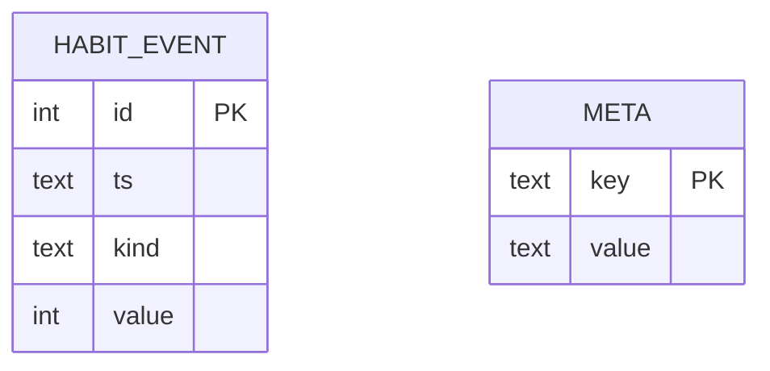

# Esquema de Back-end — Pulso

> Como os dados são **guardados, organizados e protegidos**.
> Última revisão: 2026-11-05

## 1. Visão geral do armazenamento
Não há servidor nem login: tudo fica em **3 arquivos locais** na pasta de dados do usuário
(`%LOCALAPPDATA%\Pulso\`, ou a pasta definida em `PULSO_DATA_DIR`):

| Arquivo | O que guarda | Formato | Usado por |
|---------|--------------|---------|-----------|
| `config.toml` | Preferências do dono | TOML | F01, F02, F04, F07, F08, F10 |
| `cerebro.npz` | O que o pet **aprendeu** (pesos e estado da rede) | numpy `.npz` | F03, F04 |
| `pulso.db` | Eventos de **hábito** (água, pomodoro) | SQLite | F07, F08, F09 |
| `logs/pulso.log` | Eventos técnicos, sem dados de sensor | texto rotativo | todos |

**O que nunca é gravado:** leituras de sensor (CPU, RAM, processo, categoria, ociosidade), linha do tempo de
humores, nomes de programas usados. Esses dados existem só na memória, no laço de 1 s. Assim a decisão em
aberto "histórico em disco ou só pesos" fica resolvida: **só pesos e eventos de hábito**.

## 2. Autenticação e autorização
Não se aplica. O programa é de um usuário só e não abre rede. A proteção vem da pasta de usuário do Windows.

## 3. `cerebro.npz`
| Chave | Forma | Descrição |
|-------|-------|-----------|
| `format_version` | escalar int | Versão do formato (começa em 1); carregador recusa versão desconhecida com aviso |
| `engine` | string | Nome do motor (`numpy_lif_rstdp`); trocar de motor não reaproveita pesos de outro |
| `groups` | (5,) string | Ordem dos humores nos grupos de saída |
| `w_in_hid` | (n_in, n_hid) float32 | Pesos entrada→oculta (plásticos) |
| `w_hid_hid` | (n_hid, n_hid) float32 | Recorrência da oculta (fixa no MVP) |
| `w_hid_out` | (n_hid, n_out) float32 | Pesos oculta→saída (plásticos) |
| `mask_*` | mesmas formas, bool | Quais conexões existem (esparsidade) |
| `reward_baseline` | escalar float | Média recente das recompensas (r̄) |
| `seed` | escalar int | Semente que gerou a rede (reprodutibilidade) |
| `stats` | (3,) int64 | Total de recompensas positivas, negativas e de passos simulados |
| `saved_at` | string ISO | Quando salvou |

- Potenciais de membrana e rastros **não** são salvos: zeram ao abrir, como "acordar".
- Gravação **atômica**: escreve `cerebro.npz.tmp` e depois renomeia, para não corromper se faltar energia.
- Salvamento a cada 5 min, ao pausar e ao sair.

## 4. `pulso.db` (SQLite)


### habit_event
**Para quê:** cada acontecimento de hábito · **Usada por:** F07, F08, F09, T03

| Coluna | Tipo | Obrigatória | Padrão | Descrição / regras |
|--------|------|-------------|--------|--------------------|
| id | INTEGER | sim | auto | Chave primária |
| ts | TEXT | sim | agora | Data e hora local, formato ISO 8601 |
| kind | TEXT | sim | — | Um de: `water_drunk`, `water_snoozed`, `pomodoro_focus_done`, `pomodoro_break_done`, `pomodoro_skipped`, `break_streak_end` |
| value | INTEGER | não | NULL | Dado extra; em `break_streak_end` são os minutos de trabalho seguidos antes da pausa |

- **Índice:** `ts` (consultas de "hoje" e "últimos 7 dias").
- `CHECK (kind IN (...))` garante os valores permitidos.

### meta
**Para quê:** chave e valor do próprio banco, como `schema_version`.

## 5. `config.toml` (padrões)
```toml
[pomodoro]
focus_min = 25
break_min = 5
long_break_min = 15
cycles_before_long = 4

[water]
interval_min = 45
snooze_min = 10

[privacy]
pause_hotkey = "Ctrl+Alt+P"
auto_resume_min = 0          # 0 = nunca retoma sozinho

[brain]
hidden_neurons = 100
learning_rate = 0.01
owner_reward_weight = 1.0
rule_reward_weight = 0.3

[categories]                 # acrescenta ou sobrepõe a tabela embutida
"code.exe" = "codigo"
"chrome.exe" = "navegador"

[system]
start_with_windows = false
```
- Cada campo tem limites (ex.: `focus_min` entre 5 e 120). Um valor inválido volta ao padrão, com aviso no log.

## 6. Regras de dados
- Exclusão: o dono pode apagar a pasta de dados a qualquer momento. "Recomeçar cérebro" (T04) guarda antes
  um backup `cerebro_bkp_<AAAAMMDD-HHMMSS>.npz`.
- Os eventos de hábito são mantidos indefinidamente (são poucos: algumas dezenas por dia).
- Nada vai para o repositório: os dados ficam fora da pasta do projeto (`%LOCALAPPDATA%\Pulso\`) e, por
  garantia, o `.gitignore` bloqueia `*.npz`, `*.db`, `logs/` e `data/`.

## 7. Migrações, backup e dados iniciais
- **Primeiro uso:** cria a pasta, o `config.toml` com os padrões, um `pulso.db` vazio
  (`schema_version = 1`) e uma rede nova a partir da semente.
- **Migrações:** `storage/db.py` aplica scripts em ordem pelo `schema_version`. O `.npz` usa `format_version`:
  uma mudança no formato exige uma função de conversão ou um "recomeçar com backup".
- **Backup:** basta copiar a pasta `%LOCALAPPDATA%\Pulso\`.

## 8. Suposições
- O SQLite basta, sem ORM (consultas simples, com o módulo `sqlite3` da biblioteca padrão).
- A recorrência da camada oculta é fixa (não aprende) no MVP, para simplificar.

## 9. Perguntas em aberto
- Nenhuma no momento.

## Histórico de revisões
| Data | Mudança |
|------|---------|
| 2026-11-05 | Versão inicial |
