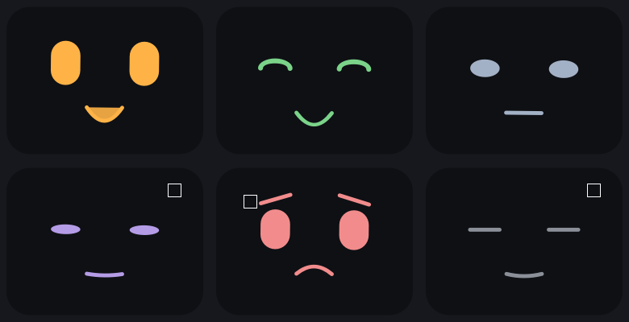

# Etapa 4 — O pet aparece (2026-11-06)

> Objetivo: primeira versão "de verdade", usável no dia a dia.

## O que foi feito
- `controller.py`: `PetController`, o laço de 1 s **sem Qt**: sensor → `engine.step(encode(frame), 100)` →
  `decoder.update` → `rules.evaluate` (se > 0, `engine.reward`) → `saver.tick()`. Também guarda
  `owner_reward(±1)`, `pause()`, `resume()` e `shutdown()` (os dois últimos gravam o cérebro).
- `ui/pet_widget.py`: o rosto desenhado com `QPainter` — 5 humores mais "dormindo", transição suave,
  piscar a cada 3–6 s, olhar de lado, inclinação leve, pulinho do "animado" e emojis que sobem (💚/💢).
- `ui/main_window.py`: abas (só "Pet" por enquanto), legenda que explica o humor, selo "😴 Observação pausada" (só quando pausado), balão de
  fala, botões Carinho e Bronca, botão de pausa só com ícone (⏸/▶) na mesma linha, e o `QTimer` de 1 s.
- `ui/app.py`: abre o cérebro salvo ou cria um novo; no primeiro uso, mostra a fala de boas-vindas (J01);
  segue o tema claro/escuro do Windows. `pulso` abre a janela; `pulso --fake-sensors` usa o roteiro falso.
- `ui/theme.py` e `ui/phrases.py`: paleta do Design Brief §3 e as falas (tom do §8).
- Dependência nova: `PySide6`.
- 31 testes novos (154 no total; `pytest -m "not slow"` roda 150 em ~13 s).

## Conceitos aprendidos

### Qt em três ideias
- **Laço de eventos.** Um app Qt não "roda de cima a baixo": `app.exec()` entra num laço que espera eventos
  (clique, timer, pintura) e chama o código certo para cada um. Tudo que escrevemos é uma resposta a evento.
- **Sinais e *slots*.** Um botão *emite* o sinal `clicked`; `botao.clicked.connect(metodo)` diz "quando isso
  acontecer, chame `metodo`" (o *slot*). Quem emite não sabe quem escuta — por isso a janela pode ligar os
  botões ao controlador sem que o botão conheça o controlador.
- **`QTimer`.** Emite `timeout` a cada intervalo, **dentro** do laço de eventos, sem threads. Nosso laço de
  1 s é só `timer.timeout.connect(self.tick)`. Cabe na thread da interface porque a volta inteira custa
  ~3 ms (sensor + rede); se um dia passar de ~20 ms, vale mover a rede para outra thread (TRD §5.1).

### Desenhar com QPainter, e animação por suavização
O `paintEvent` é chamado pelo Qt sempre que o widget precisa ser repintado; ali usamos um `QPainter` para
desenhar retângulos arredondados (olhos), arcos, curvas de Bézier (boca) e texto (emojis). Não há imagens.

Para animar, cada humor é só **uma lista de números** (abertura do olho, curva da boca, ...), e o desenho
sempre usa os números *atuais*. A cada quadro, cada número anda uma fração do caminho até o alvo:
`atual += (alvo − atual) · (1 − e^(−dt/τ))` com τ = 0,12 s. É o mesmo decaimento exponencial do neurônio
LIF, aplicado ao rosto: a troca de humor leva ~0,4 s, é suave e **não precisa de uma animação pronta para
cada par de humores** (5×5). Usar `dt` na fórmula faz a velocidade não depender de quantos quadros por
segundo o computador consegue.

### Um app que não gasta CPU parado
O relógio de quadros (33 ms) só roda quando há algo se mexendo: ele **para** quando o pet está dormindo e já
assentou, e para quando o widget é escondido (`hideEvent`: janela minimizada ou outra aba). Quando o humor
muda ou o widget reaparece, volta a rodar. O pet dormindo não pisca nem se mexe: o mesmo que a pausa de
privacidade pede ("olhos fechados, sem animação").

### Separar a lógica da janela para poder testar
A lógica do "o que acontece a cada segundo" ficou no `PetController`, que não importa Qt. Assim os testes
dele rodam em milissegundos com relógio e sensor falsos. A janela é fina: traduz clique em chamada ao
controlador e resultado em desenho. Os testes da janela usam a plataforma `offscreen` do Qt (sem tela) e
chamam `botao.click()` e `window.tick()` direto, sem esperar o timer de verdade.

### Contraste não é opinião
O Design Brief pedia 4,5:1 nos textos "conferido com uma ferramenta". Escrevi a fórmula do WCAG como teste
(`tests/ui/test_theme.py`) e ele reprovou meu próprio rascunho: **texto branco sobre `#0F8A7E` dava 4,24:1**.
Escureci a primária clara para `#0D7F74` (4,88:1) e atualizei o Design Brief. Moral: cor que "parece boa" não
é critério; o teste é.

## Decisões e observações
- **Ajustes pedidos pelo dono após ver a janela (2026-11-06):** sem emoji de olho; sem selo fixo "Observando"
  (o selo só aparece pausado); botão de pausa pequeno no canto; Carinho/Bronca fazem o rosto reagir por
  ~2,5 s e voltar ao humor (antes ficava preocupado com a fala "que bom!"); toda expressão ganhou legenda
  com o significado e uma dica (tooltip) de que o humor vem da rede.
- **Segunda rodada (mesmo dia):** pausa vira botão só com ícone ao lado de Carinho/Bronca; a legenda do humor
  foi para cima do rosto; a janela abre sempre no tamanho mínimo.
- **Tamanho mínimo no Qt:** `minimumSizeHint()` não conta as quebras de linha de `QLabel` com `wordWrap`, e a
  primeira versão cobriu o rosto com o balão. A altura sai de `layout.totalHeightForWidth(largura)`, e a legenda
  e o balão reservam 2 e 3 linhas. Teste: o texto quebrado cabe na altura reservada.
- **Arquivo do cérebro ilegível:** ele nunca é apagado. É **renomeado** para
  `cerebro.recusado-AAAAMMDD-HHMMSS.npz`, o dono é avisado numa caixa de mensagem e começa um cérebro novo.
  (A etapa 3 deixou essa escolha para a interface.)
- **Primeiro uso:** o `cerebro.npz` é gravado logo na criação; a existência dele é o que diz "já houve
  primeiro uso". A fala de boas-vindas só é trocada quando o dono clica em algo ou depois de 30 s.
- **Pausa:** `pause()` grava o cérebro; enquanto pausado, o laço não lê o sensor, não simula, não recompensa e
  os botões Carinho/Bronca ficam desligados (testado: `sensor.calls` não muda e os pesos ficam idênticos).
- **Retorno visual imediato** do Carinho/Bronca é o emoji que sobe do rosto + a fala; ele aparece mesmo se o
  filtro de cliques repetidos ignorar a recompensa (o dono vê que o clique "pegou", a rede não é reforçada
  duas vezes).
- Antes da primeira decisão da rede (~10 s) o pet usa um olhar "neutro", que não é um dos 5 humores.
- `pulso` sem argumentos agora abre o app (antes imprimia a ajuda; `pulso --help` continua existindo).

- **Barra de abas escondida** enquanto houver só a aba "Pet" (o título da janela já é "Pulso"); volta com a etapa 5.
- **Teste de uso do dono (2026-11-06):** o pet passou por todos os humores; a janela e as legendas foram aprovadas.
  Pedido novo, para a etapa 6: rever os tempos de descanso e água e registrar se o dono fez ou recusou.
  Ideia do dono: a recusa/omissão **acumula**; com muita pendência o pet fica nervoso e preso nesse humor até o
  dono admitir que fez a pausa ou bebeu água (detalhes e pontos em aberto no plano, etapa 6).

## Medições
- Piloto de 60 s (app real, sensores reais, pasta de dados temporária): **0,10% de CPU** (da máquina inteira) e
  **149 MB de RAM**. Metas do PRD §4: < 3% e < 200 MB.
- Teste real de 1 h (app com a interface final): em andamento; o resultado entra neste diário antes do merge.

## Como testar
- `pytest` — todos os testes; `pytest -m "not slow"` — sem os 4 de aprendizado (~13 s).
- Ver o app: `pulso` (sensores reais) ou `pulso --fake-sensors` (roteiro de 4 momentos). Para não mexer nos
  seus dados: `$env:PULSO_DATA_DIR = "$env:TEMP\pulso-teste"` antes de rodar.
- No Windows, o `python.exe` de um venv é um *launcher* que cria um processo filho: ao medir CPU/RAM é preciso
  somar o processo e os filhos (o pai sozinho mostra 4 MB).

## Tropeços (para não repetir)
- Heredocs longos no shell quebram com aspas; scripts e arquivos grandes vão com a ferramenta Write.
- No modo `offscreen` do Qt faltam fontes: textos e emojis viram quadradinhos nas capturas. Não é bug do app
  (no Windows real aparecem); serve só para conferir o formato dos rostos.
- Sobrancelha "preocupada" inclinada para o lado errado parece **brava**. A ponta de dentro tem de ficar
  *mais alta*; as capturas de tela pegaram isso.

## Ficou para depois
- Bandeja do sistema, atalho global da pausa e ícone: etapa 6 (hábitos) e seguintes — hoje a pausa é só pelo botão.
- A aba "Cérebro" e `snapshot()`: etapa 5.
- A semente 3 que não aprende (homeostase) continua em aberto (diário da etapa 3).
- Observar no uso real (dias) se o pet começa a acompanhar o gosto do dono: as recompensas são raras.

## Para a etapa 5 (ponto de partida)
**Estado:** o pet aparece e responde a Carinho, Bronca e Pausar; o cérebro aprende e é salvo a cada 5 min,
ao pausar e ao sair. A aba "Cérebro" ainda não existe.
- **Ler antes:** PRD F06, Design Brief §6 e T02, plano da etapa 5.
- **Peças prontas:** `MainWindow` tem um `QTabWidget` (basta `addTab`); o `PetController` tem acesso ao motor
  (hoje privado, `_engine`) — a etapa 5 vai precisar de `snapshot()` no `Engine` e de um jeito de a aba lê-lo.
- **Atenção:** a aba oculta não pode redesenhar nem consumir CPU (F06); o `PetWidget` já faz isso com
  `hideEvent` e serve de modelo.
