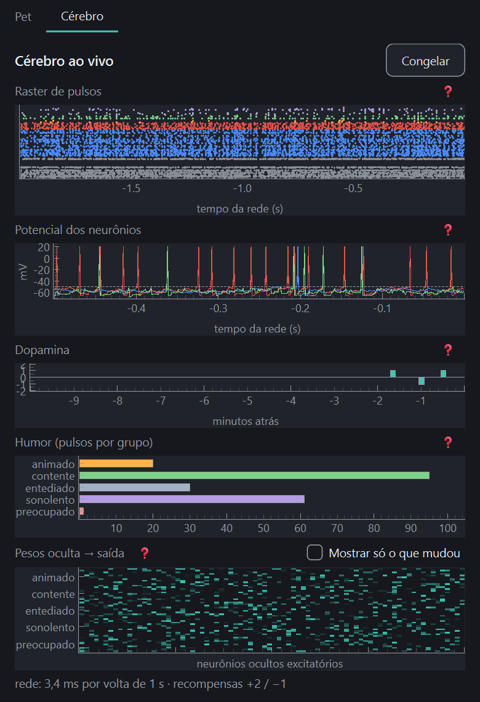

# Etapa 5 — Ver o cérebro (2026-11-06)

> Objetivo: a aba Cérebro mostra a rede ao vivo.

## O que foi feito
- `Engine.snapshot()` (contrato e `NumpyEngine`): uma fotografia com os pulsos de **todos** os neurônios e o
  potencial de 3 deles nos últimos 2 s de rede, mais os pesos oculta→saída, a última dopamina, r̄ e a contagem
  de recompensas. Tudo em cópias: a aba não consegue estragar a rede.
- `Engine.reward()` agora **devolve** a dopamina entregue (`value − r̄`), para o gráfico poder desenhá-la.
- `PetController`: guarda a lista das últimas entregas de dopamina (`dopamine_events`, com o relógio real, o
  valor e a **fonte**: "dono" ou "regra"), mede o custo da volta (`step_cost_ms`) e expõe `snapshot()` e
  `mood_counts()`. Cliques ignorados pelo filtro de repetição não viram evento.
- `ui/brain_tab.py`: cinco gráficos em pyqtgraph, ❓ em cada um, Congelar/Continuar, "Mostrar só o que mudou" nos
  pesos e o rodapé com o custo da rede.
- `MainWindow`: aba "Cérebro", barra de abas visível, Ctrl+1/Ctrl+2, e a janela **cresce** ao abrir o Cérebro e
  volta ao tamanho do pet ao voltar (o pet continua abrindo compacto).
- 27 testes novos (181 no total; os 4 de aprendizado seguem verdes e a rede não mudou: o registro dos gráficos não
  consome números aleatórios).

## Conceitos aprendidos

### Como ler um raster
Cada **ponto** é um pulso; cada **linha** é um neurônio; o eixo horizontal é o tempo. Três coisas para olhar:
1. **Densidade** — uma faixa cheia de pontos é uma camada muito ativa; vazia, uma camada calada. Na captura acima,
   a entrada (cinza, embaixo) e a oculta excitatória (azul) pulsam muito; a saída (as cores dos humores, em cima) é
   esparsa, e é por isso que ela decide: poucos pulsos, mas de quem vence a competição.
2. **Sincronia** — colunas verticais de pontos são muitos neurônios disparando juntos. Um pouco é normal; uma
   parede inteira é a rede "convulsionando" (o que a camada inibitória, em vermelho, existe para evitar).
3. **Faixas por grupo** — na saída, cada grupo de 10 linhas é um humor. O grupo com mais pontos é quem está ganhando.

### O que observar quando a rede aprende
Aprender, aqui, é mexer nos pesos oculta→saída quando a dopamina chega. Então:
- **Dopamina:** a barra aparece no instante do carinho/bronca/regra. A primeira recompensa é a maior (tudo é
  surpresa, r̄ = 0); recompensas iguais em sequência vão ficando **menores** (r̄ já as espera). É o erro de
  previsão da etapa 3, agora visível.
- **Pesos:** o mapa bruto quase não muda a olho nu (a taxa de aprendizado é pequena e a soma por neurônio é
  mantida). Por isso existe **"Mostrar só o que mudou"**: ele subtrai os pesos de quando o app abriu. Verde-água é
  sinapse que ficou mais forte, vermelho é a que enfraqueceu; como a normalização redistribui, os dois aparecem
  juntos.
- **Humor:** com o tempo, o grupo recompensado em certos contextos deve passar a ganhar nesses contextos. Isso leva
  dias de uso (a J03); **não foi verificado ainda**.

### Os dois relógios, de novo
A rede simula 100 ms a cada 1 s real. Os eixos de pulsos e potencial estão em **tempo de rede**; o de dopamina, em
**minutos reais**. Por isso o raster mostra "2 s" que na verdade costuram ~20 s de uso, e a dica ❓ avisa isso.

### Um registro circular para os gráficos
Para desenhar "o que aconteceu há pouco" o motor precisa lembrar, mas sem crescer sem parar. Solução clássica: um
**buffer circular** (uma matriz de 2000 colunas, 1 por ms). Cada passo escreve na coluna `contador % 2000`; ao
fotografar, `np.roll` coloca a coluna mais antiga na frente. Memória fixa (~0,5 MB), custo por passo de uma escrita
de ~213 booleanos. Há um teste para a ordem depois que ele "dá a volta".

### Desenhar só quando alguém vê
A aba **não tem timer**. Quem a atualiza é o laço de 1 s da janela, e `refresh()` volta logo se a aba está oculta
(outra aba, janela minimizada) ou congelada: nem pede a fotografia. Isso é testado contando as chamadas ao
`snapshot()` (zero). Ao reaparecer (`showEvent`) ela se põe em dia na hora. Mesma ideia do `hideEvent` do pet.

### pyqtgraph em três linhas
`PlotWidget` é o gráfico; itens (`ScatterPlotItem`, `BarGraphItem`, `ImageItem`, linhas) são adicionados a ele e
reaproveitados a cada atualização com `setData`/`setOpts` (criar itens novos a cada segundo vazaria memória). Um
`ScatterPlotItem` por camada/humor, cada um com uma cor só, é bem mais barato do que uma cor por ponto.

## Decisões e observações
- **Rodapé = custo da volta, não do passo.** O Design Brief dizia "passo: 2,1 ms". Um passo de 1 ms custa ~0,03 ms;
  o que o orçamento do TRD (§5.1) limita é a volta inteira de 100 passos (20 ms). O rodapé diz
  "rede: 3,3 ms por volta de 1 s".
- **Potencial só dos últimos 500 ms.** Em 2 s, os picos viravam uma parede ilegível. O pico é desenhado a +20 mV
  (o neurônio é resetado no mesmo passo; só o desenho é cosmético).
- **Os três neurônios do potencial são fixos** (uma oculta excitatória, uma inibitória e a primeira de saída). O
  seletor "neurônio 12 ▾" do rascunho do Design Brief ficou de fora: ninguém pediu e o ganho é pequeno.
- **A aba pode ser congelada**, mas a rede continua rodando por baixo (a pausa de privacidade é outra coisa: com
  ela, o laço para e a aba não é atualizada).
- **Tamanho da janela:** a aba Cérebro precisa de ~520×760 (mínimo 420×700; abaixo disso os eixos são cortados). O
  pet continua no tamanho mínimo: a janela cresce ao abrir o Cérebro e volta ao voltar ao Pet.
- **Pesos:** mostra só as sinapses que aprendem (80 oculta excitatória × 50 saída). A camada entrada→oculta está
  congelada (diário da etapa 3), então não entra.

## Medições
- Volta do laço (tick + eventos de pintura, modo offscreen, rede real): **3,2 ms com o pet, 12,8 ms com o Cérebro
  visível, 3,2 ms com a janela escondida**. `refresh()` sozinho: ~5,7 ms. Dentro do orçamento (< 20 ms).
- **Não medi CPU de processo em uso real** com a aba aberta por um tempo (só a volta do laço). ~13 ms por segundo é
  ~1,3% de um núcleo; a meta do PRD é < 3% da máquina.

## Como testar
- `pytest` (181, ~1,5 min) ou `pytest -m "not slow"` (~20 s).
- Ver a aba: `pulso --fake-sensors` e clicar em "Cérebro" (ou Ctrl+2). Para não mexer nos seus dados:
  `$env:PULSO_DATA_DIR = "$env:TEMP\pulso-teste"`.
- Clique em Carinho/Bronca algumas vezes (com mais de ~3 s entre os cliques) e veja as barras de dopamina; marque
  "Mostrar só o que mudou" nos pesos.

## Tropeços (para não repetir)
- **O pyqtgraph cria `QMenu`s de topo que pertencem ao Python.** A limpeza do `qapp` (etapa 4) apagava *todos* os
  `topLevelWidgets()`, inclusive esses menus, e o Qt abortava no `DeferredDelete` (`Fatal Python error: Aborted`,
  só em janelas nunca exibidas). Agora a limpeza só fecha as `QMainWindow`.
- **Eixo "(x0.001)":** o pyqtgraph troca segundos por milissegundos sozinho (prefixo SI). `enableAutoSIPrefix(False)`.
- **Alturas mínimas somadas passam da altura da janela** e os eixos desaparecem sem erro nenhum: só a captura com as
  fontes do Windows mostrou. (No modo `offscreen` o texto vira quadradinhos; para conferir layout, rode sem
  `QT_QPA_PLATFORM=offscreen` e salve `window.grab()`.)
- O `QToolButton` com `clicked` + `QToolTip.showText` dá a dica no clique (teclado/toque), além do mouse.

## Ficou para depois
- Conferir no uso real, ao longo de dias, se o mapa "só o que mudou" e o humor mostram o aprendizado (J03).
- O seletor de neurônio do gráfico de potencial (se um dia fizer falta).
- A semente 3 que não aprende (homeostase) continua em aberto (diário da etapa 3).

## Para a etapa 6 (ponto de partida)
**Estado:** o pet, o cérebro e a aba Cérebro funcionam; faltam os hábitos (pomodoro e água). A aba "Saúde" e a
bandeja são da etapa 7.
- **Ler antes:** PRD F07/F08, o bloco **"Revisar antes de codar"** e a **pendência cumulativa** do plano (etapa 6),
  e o Design Brief §8 (tom).
- **Decisões do dono ainda abertas:** os tempos de foco/descanso/água, os quatro desfechos (fiz, depois, recusei,
  ignorei), a conta da pendência e o rosto "nervoso". Decidir com o dono **antes** de codar.
- **Peças prontas:** `PetController` (laço de 1 s), `RewardRules`, `Clock`/`FakeClock` (relógio injetável para as
  máquinas de estado), `phrases.py` (falas) e o `QTabWidget` da janela.
