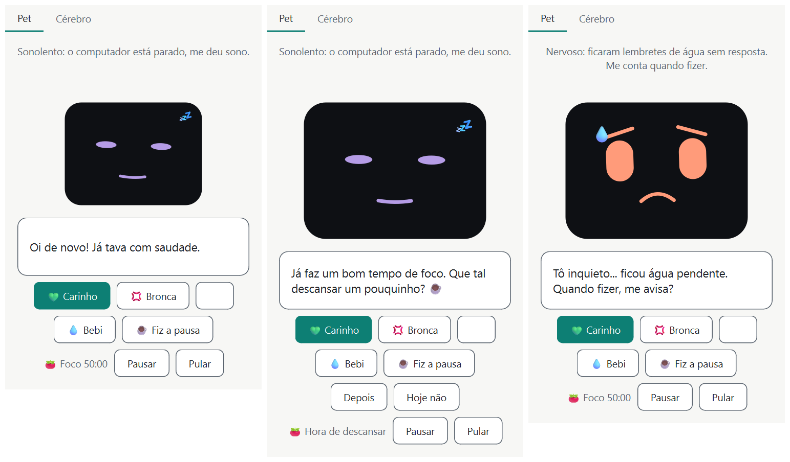

# Etapa 6 — Hábitos: pomodoro e água (2026-11-06)

> Objetivo: o Pulso cuida do dono.

## O que foi feito
- **Decisões do dono antes de codar** (plano, etapa 6): foco 50 min, descanso 10 (longo 20 a cada 4 ciclos), água a cada
  60 min. O Pulso passou a separar **fiz / depois / recusei / ignorei**. Recusar vale 2 pontos de pendência, ignorar 1,
  "depois" 0; com **3 ou mais** o pet fica **nervoso**, e só o "fiz" zera.
- `habits/reminder.py`: o lembrete genérico que **pergunta e espera**. Armado → mostrado → respondido ou ignorado.
- `habits/water.py` e `habits/pomodoro.py`: as duas máquinas de estado, puras (sem Qt, sem banco, só um `Clock`).
- `storage/db.py`: o `pulso.db` (SQLite) com a tabela `habit_event`, a `meta` e a **migração v1**.
- `habits/coach.py`: `HabitCoach`, o único que **grava** eventos. Calcula a pendência e responde "o pet está nervoso?".
- `controller.py`: `tick_habits()` (roda também com a observação pausada), `answer_habit()` e `shown_mood` (o rosto
  nervoso vence o humor da rede). `rewards.py` ganhou `habit(kind)`: atendido +, recusei −, ignorei − (menor).
- Interface: contador do pomodoro, botões **💧 Bebi** e **☕ Fiz a pausa** sempre visíveis, uma linha extra com
  **Depois / Hoje não** só durante o lembrete, rosto **nervoso** (olhos mais arregalados e leve tremor) e a
  notificação do Windows (`ui/notifier.py`).
- 95 testes novos (276 no total, os 4 de aprendizado seguem verdes: os hábitos não mudam a rede).

## Conceitos aprendidos

### Máquina de estados
Em vez de um monte de `if` espalhados ("se passou 50 min e não está pausado e ..."), o pomodoro é **um estado por vez**
(`PARADO`, `FOCO`, `PEDINDO_DESCANSO`, `DESCANSO`) e uma lista curta de **transições**: o que cada estado faz quando o
tempo passa (`tick`) e quando o dono age (`start`, `rest`, `later`, `decline`, `skip`). Para saber se algo é possível,
basta olhar o estado atual: "Depois" só faz sentido em `PEDINDO_DESCANSO`, e fora dele devolve `None`. Isso torna o
comportamento **previsível e testável**: cada teste põe a máquina num estado, anda o relógio e confere o resultado.

### O relógio falso (de novo)
O relógio injetável da etapa 1 paga aqui: um teste que "espera 50 minutos" leva 0,2 ms (`clock.advance(50 * 60)`).
Todas as regras de tempo (o ócio adia o lembrete, o "ignorei" só conta com o dono presente) foram escritas **antes** de
existir qualquer botão.

### Por que os hábitos são regras e não rede neural
A rede aprende a **ler o clima** do dono (humor), onde não há resposta certa e a imprecisão é aceitável. Um lembrete
de água é o oposto: precisa ser **exato** ("a cada 60 min"), explicável ("por que apareceu agora?") e testável. Misturar
os dois deixaria o lembrete imprevisível. Por isso os hábitos são regras, e o que chega à rede é só **recompensa**:
beber água soma, recusar subtrai, e o pet aprende em que **momentos** esse cuidado costuma ser bem-vindo. (F12, no
roteiro: aí a rede passaria a decidir *quando* lembrar. Hoje ela só recebe o resultado.)

### Presença em três estados
"O dono está aqui?" não é sim ou não. `Presence` tem **três** valores: `PRESENT`, `AWAY` (ocioso há 5 min ou mais) e
`UNKNOWN` (observação pausada ou leitura falhou). A regra de ouro: **só se acusa de "ignorei" quem se sabe que estava
presente**. Longe, o lembrete **espera a volta**; com a observação pausada (`UNKNOWN`) ele aparece, mas o relógio do
"ignorei" não anda. Esse rótulo é a única coisa que sai do sensor para os hábitos, e não é gravado.

### Pendência calculada, não guardada
Não existe coluna "pendência". Ela é **recalculada dos eventos**: soma os pontos das recusas e omissões **depois do
último "fiz"**. Vantagens: sobrevive a fechar o app sem nenhum código a mais, não há número que possa ficar
dessincronizado, e dá para mudar a conta (os pontos) sem migrar dados. A consulta é uma só, em SQL (`id > último fiz`).
Água e pausa têm pendências **separadas**: beber não "perdoa" o descanso que ficou para trás.

### Migrações do SQLite
O banco tem um `schema_version` na tabela `meta`. Ao abrir, o Pulso roda **só os scripts que faltam**, cada um numa
transação (`BEGIN`/`COMMIT`; se falhar, `ROLLBACK` e o banco fica como estava). Um banco de versão **mais nova** é
recusado, pelo mesmo motivo do `.npz`: um Pulso antigo não deve mexer no que não entende. O `CHECK (kind IN (...))`
barra tipos inventados direto no banco.

### Notificação do Windows pelo Qt
`QSystemTrayIcon.showMessage(...)` mostra o aviso. Ele exige um ícone na bandeja, então já existe um (só para isso;
o menu e os estados ficam para a etapa 7). O clique no aviso emite `messageClicked`, ligado a `bring_to_front()`.

### Uma janela que cresce uma linha
Quatro botões numa linha pediriam 416 px de largura (a janela tem 334). Em vez de alargar, "Depois / Hoje não" ficaram
numa **linha própria** que só existe com o lembrete na tela, e a janela cresce essa linha e volta depois. Detalhe de
Qt: o tamanho mínimo de um layout **não** conta um botão que acabou de ser mostrado antes de a janela existir; só a
captura real (e uma medição depois de `show()`) denunciou o corte.

## Extensão: o pet que não depende de clique (pedido do dono)
Depois do primeiro teste, o dono apontou o essencial: um pet que só existe se você o abre e clica não cumpre o propósito.
Foi adiantado da etapa 7:
- **X → bandeja.** `closeEvent` ignora o fechamento e esconde a janela (aviso na 1ª vez); o laço de 1 s e os lembretes
  seguem, e os avisos continuam saindo. **Sair do Pulso** (`quit_app`) é o fechamento de verdade: guarda o cérebro e tira
  o ícone. Sem bandeja no Windows, o X volta a encerrar como antes.
- **Fim de sessão do Windows:** um X que só esconde poderia segurar o desligamento. `commitDataRequest` chama
  `prepare_to_quit()`, que libera o fechamento.
- **Sempre à frente:** `Qt.WindowStaysOnTopHint`, ligado por padrão. Tropeço: `setWindowFlag` **esconde** a janela; o
  teste pegou meu `if isVisible()` depois dele (sempre falso). Agora a visibilidade é lida antes.
- **Iniciar com o Windows:** valor `Pulso` na chave `HKCU\Software\Microsoft\Windows\CurrentVersion\Run`, com
  `pythonw.exe -m pulso` (sem console). O registro é a fonte da verdade; o menu relê ao abrir. Os testes usam uma chave
  temporária, nunca a `Run` real.
- **Preferências em `config.toml`** (sempre à frente, lembrete de água), lidas com `tomllib` e escritas à mão e de forma
  atômica; arquivo quebrado ou valor de tipo errado volta ao padrão.
- **Aprender com o dono (F12):** o interruptor de água fica **salvo**. Desligá-lo, e as recusas e omissões, são o tipo de
  sinal que o F12 usaria para a rede aprender *quando e como* lembrar. Hoje só guardamos a escolha; o aprendizado do
  momento certo é a próxima fronteira, não esta etapa.
- 18 testes novos (276 no total, saída 0 no PowerShell). Arranque real: o app abriu, ficou vivo e criou `cerebro.npz` e
  `pulso.db`. **Não verificado:** reiniciar o Windows para ver o pet abrir sozinho; o fim de sessão com o pet aberto; se o
  ícone aparece logo no login (a bandeja pode ainda não existir; o Qt a adiciona quando ela surge).

- **Atalho no Menu Iniciar:** `pulso --criar-atalho` grava `Pulso.lnk` em `%APPDATA%\...\Start Menu\Programs` (sem
  administrador) e o ícone `pulso.ico` na pasta de dados. O `.lnk` é um arquivo binário do Windows, então o PowerShell
  o cria via `WScript.Shell`, com os valores passados por variáveis de ambiente (sem tropeçar em aspas). Aponta para
  o `pythonw.exe` do mesmo ambiente, como o "Iniciar com o Windows". Os testes criam o `.lnk` numa pasta temporária.
- **Botões e balões:** botões secundários menores e pomodoro em ícones; a dica de cada botão vira fala do pet ao passar o
  mouse (`eventFilter`), sem o balão padrão do Windows. O ícone de pausa em branco era a cor de texto do sistema (modo
  escuro) sobre o fundo claro do tema: agora usa a cor do tema.

- **Atividades do pet (descansar e beber):** `PetWidget.rest(contagem)` e `PetWidget.drink()` põem uma aparência por
  cima do humor da rede ("descansando" e "bebendo", em `LOOKS`). A pausa de privacidade (dormindo) vence a atividade, e
  uma reação ao carinho/bronca vence as duas. O descanso dura enquanto a fase BREAK do pomodoro (a janela chama `rest`
  a cada segundo com o tempo que falta); beber dura 15 s, medidos no relógio de animação do widget (`advance`), e depois
  volta ao descanso, se ele ainda estiver rolando. Não foi feita a "cutucada" se o dono mexe no PC durante a pausa: pediria
  levar a ociosidade do sensor até a janela, e fica para quando o F12 mexer nisso.

- **Recompensa por hábito, não por processo (decisão do dono):** as três regras por processo/ócio (ócio → sonolento,
  volta → animado, 90 min sem pausa → preocupado) eram palpites sobre o humor que o dono nunca confirmava. Ficam
  **desligadas por padrão** (`auto_enabled`), ligáveis em Ajustes. Bebi, fiz a pausa e hoje não pesam agora como carinho
  e bronca (`habit_weight` 1,0). Ressalva honesta, anotada para o F12: a recompensa de hábito reforça o humor que a
  rede mostrava naquele segundo, o que ainda não ensina *quando* lembrar; isso só passa a valer quando a rede
  decidir o momento do lembrete.
- **Ajustes (tempos):** `Settings` ganhou `focus_min`, `break_min`, `long_break_min` e `water_interval_min`, com
  intervalos válidos (`RANGES`). `HabitCoach.apply_config` troca os tempos sem reiniciar: o pomodoro usa o novo a partir
  da próxima fase e a água se rearma na hora (se não há balão). Conceito: um dado imutável (`HabitConfig`) é
  *trocado inteiro* em vez de editado, o que evita estados pela metade.
- **Jogo (jokenpô e par ou ímpar):** `game.py` é regra pura, com o sorteio injetado (`random.Random`) para os testes
  controlarem a jogada do pet. O pet joga limpo: sorteia sem espiar. O resultado só muda o rosto (contente/**bravo**, um
  look novo com sobrancelha para baixo e tremor) e o placar (`game_result`), e **não entra na rede**: ganhar ou perder
  é sorte, e viraria ruído no que ela aprende. A aba Jogo tem um `PetWidget` próprio, porque a aba Pet fica escondida
  enquanto se joga.

## Decisões e observações
- **Pendência por hábito.** O plano dizia "só o 'fiz' zera" sem dizer qual. Escolhi **um por hábito** (água × pausa):
  bom para a legenda ("ficaram lembretes de **água** sem resposta") e justo com quem só falha em um dos dois.
- **Recusar e ignorar fazem o pomodoro seguir em frente** (novo foco, sem descanso). O contador do descanso longo
  **não** zera, então o próximo descanso aceito ainda é o longo.
- **O pomodoro conta em tempo de relógio**, não de presença: independe da pausa de privacidade (critério do F07). O que
  espera o dono voltar é só a **pergunta** do descanso.
- **Fim do descanso começa o próximo foco sozinho** e avisa "hora de voltar" (a suposição do doc 03 era só avisar).
- **"Fiz a pausa" em pleno foco** registra o descanso e reinicia o foco (o dono avisa que já descansou).
- **Hábito é "regra" na aba Cérebro:** a barra de dopamina de um "Bebi" tem a cor das regras automáticas (âmbar).
- **Fora do escopo desta etapa:** suavizar/desligar o nervoso (F10, etapa 7), iniciar/pausar/pular pelo menu da bandeja
  (etapa 7, junto com `tray.py`) e `break_streak_end` (F09).

## Como testar
- `pytest` (276, ~1,2 min) ou `pytest -m "not slow"` (~20 s). Os testes de hábitos usam banco na memória e relógio falso.
- Ver no app (sem mexer nos seus dados): `$env:PULSO_DATA_DIR = "$env:TEMP\pulso-teste"; pulso --fake-sensors`.
  Clique em **🍅 Iniciar**; para não esperar 50 min, o caminho curto é **Pular** (vai direto à pergunta do descanso).
  Recuse duas vezes ("Hoje não" ou "Pular" na pergunta) e veja o pet ficar nervoso; **💧 Bebi** / **☕ Fiz a pausa** o acalmam.

## Tropeços (para não repetir)
- **Colar scripts grandes no shell** falhou por causa de aspas e acentos: para edições longas, gravar o script num
  arquivo e rodá-lo (e conferir com `assert` que a troca aconteceu).
- **Layout invisível:** a largura mínima do layout não mudava ao exibir os botões antes do `show()`. Conferido com
  captura real (sem `offscreen`).
- **Não verificado nesta máquina:** o aviso do Windows aparecendo de fato na tela (a API respondeu: bandeja disponível e
  `supportsMessages()` verdadeiro) e o ícone de pausa, que aparece em branco na captura do código de antes e do
  de agora (igual nos dois, então não vem desta etapa; não investiguei a causa).
